<p align="center">
  
</p>

# BIN

🌐 [português](README.md) · **English** · [español](README.es.md)

🗨️ **v3 beta 1** ⚡ After Effects extension for **reverse engineering of layers** ⚡

**BIN** reads the selected layers (or a **whole comp**, with its precomps) and generates a **.jsx** script that recreates everything from scratch, in any project: properties, keyframes with easing and tangents, expressions, effects, masks, shapes, texts, markers, parenting, track matte and the comp settings.

It turns a finished layout into a tool: the generated script can become a button in another panel, a template or a piece of automation.

<p align="center">
  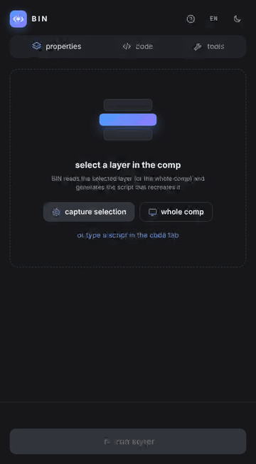<br>
  <sub>the panel in action: capture, leave out a property and an effect, see the code, recreate, and the whole comp.</sub>
</p>

> 📂 **files:**\
> • **INSTALAR O BIN.jsx** → installer (runs inside After Effects; the name is Portuguese for “install BIN”).\
> • **bin-cep/** → the extension (CEP panel).\
> • **instalar_windows.bat** / **instalar_mac.command** → alternative installers, without opening After Effects.

<br>

## 📑 contents

1. [install](#1--install)
2. [capture](#2--capture)
3. [choose what goes into the script](#3--choose-what-goes-into-the-script)
4. [whole comp](#4--whole-comp)
5. [the generated code](#5--the-generated-code)
6. [recreate, copy and export](#6--recreate-copy-and-export)
7. [tools](#7--tools)
8. [what gets recreated](#-what-gets-recreated)
9. [development](#-development)

<br>

---

## 1 · install

> ✅ **requirements:** After Effects **2020 (17.0)** or newer.

**1.1** in After Effects, open `File` > `Scripts` > `Run Script File...` and choose **INSTALAR O BIN.jsx** straight from the BIN folder (the folder that has `bin-cep` inside).

**1.2** the installer checks what is needed. if file writing is blocked, use the **› open scripting & expressions preferences** link, check *Allow Scripts to Write Files and Access Network* and click **› check again**.

<table>
  <tr>
    <td align="center">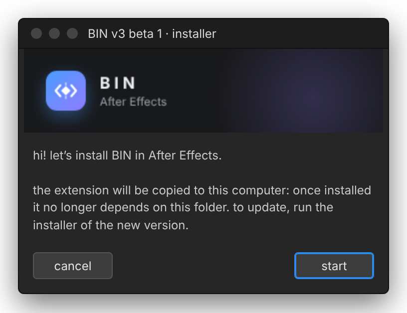<br><sub>1.1 · welcome</sub></td>
    <td align="center">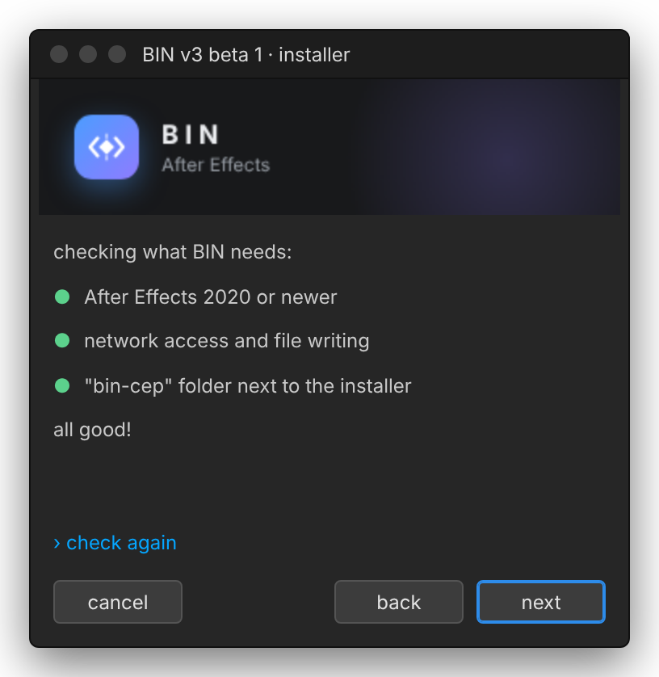<br><sub>1.2 · checks</sub></td>
  </tr>
</table>

when everything is fine, **start** skips the checks and goes straight to install / update (the checks are still one click away in **back**). if something fails, the installer stops there and explains what to fix.

**1.3** choose **install** (or **update** / **reinstall**; **remove** uninstalls) and **restart After Effects**.

<table>
  <tr>
    <td align="center">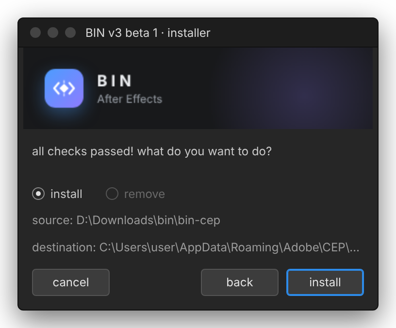<br><sub>1.3 · action</sub></td>
    <td align="center">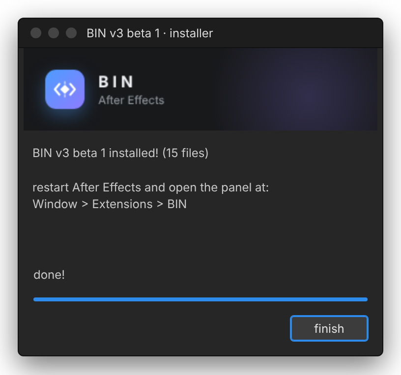<br><sub>1.3 · done</sub></td>
  </tr>
</table>

**1.4** open the panel at `Window` > `Extensions` > `BIN`.

> 💡 without opening After Effects: run **instalar_windows.bat** (Windows) or **instalar_mac.command** (macOS). both make the same copy and allow unsigned extensions (`PlayerDebugMode`).

<br>

---

## 2 · capture

open the panel at `Window` > `Extensions` > `BIN`. it can be docked anywhere in the workspace, like the other panels.

<table>
  <tr>
    <td width="300">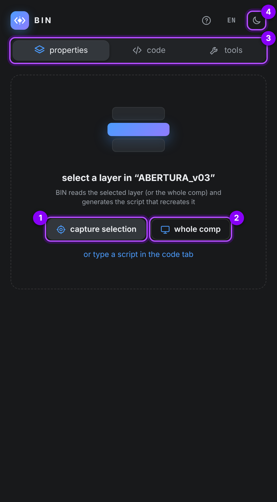</td>
    <td>

1. **capture selection** → reads the selected layers in the active comp.
2. **whole comp** → reads the active comp with all its layers and precomps. see [section 4](#4--whole-comp).
3. **tabs** → `properties`, `code` and `tools` (shortcuts `1` `2` `3`).
4. **theme** → automatic (follows After Effects), light or dark.

  </td>
  </tr>
</table>

capturing is **read-only**: nothing in the project changes and the undo history stays clean.

<br>

---

## 3 · choose what goes into the script

<table>
  <tr>
    <td width="300">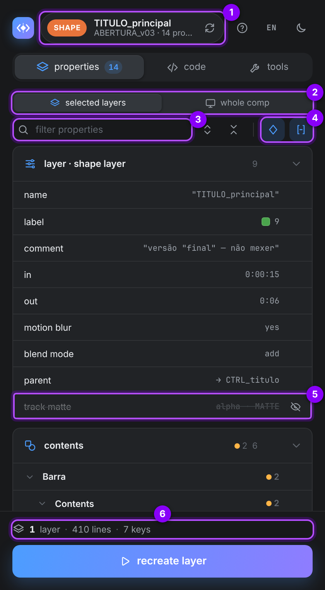</td>
    <td>

1. **chip** → layer type (`SHAPE`, `TEXT`, `SOLID`, `NULL`, `ADJ`, `CAM`, `LIGHT`, `COMP`, `MEDIA`), source comp and counts. click it (or `Ctrl/⌘ + L`) to update the capture. the panel follows the selection in After Effects: when it changes (or, in whole comp mode, when another comp becomes active), the chip is highlighted and shows **update to “…”**, without recapturing by itself and without moving the rest of the panel. on the start screen, the button already says what will be captured.
2. **mode** → `selected layers` or `whole comp`. switching captures again.
3. **filter** → by property, group or layer name (`Ctrl/⌘ + F`).
4. **keyframes and expressions** → turn them on and off for the whole script. without keyframes, each property gets the value of its first keyframe.
5. **row left out of the script** → click the row to leave the property out; it gets struck through. click again to bring it back.
6. **summary** → layers, script lines and keyframes that go in.

  </td>
  </tr>
</table>

only **modified** properties are listed: different from the default, keyframed or with an expression. the yellow **diamonds** are keyframes and the violet **ƒ** is an expression.

<table>
  <tr>
    <td width="300">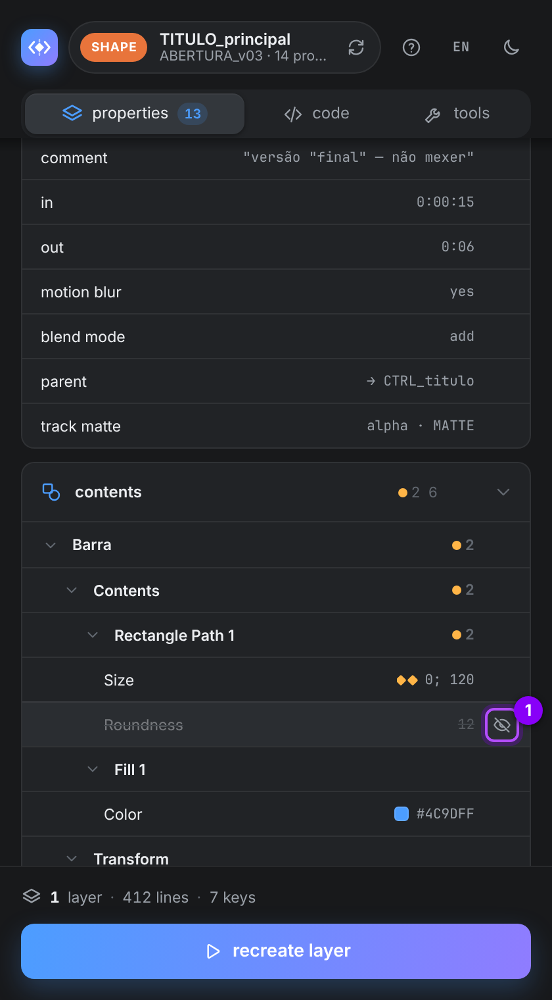</td>
    <td>

1. **eye** → shows up on hover. on properties, the whole row is clickable; on groups, cards and layers, the eye leaves the whole group out (an effect, a mask, a shape group).

a steady blue eye on a **closed** group means part of it is left out of the script.

  </td>
  </tr>
</table>

<table>
  <tr>
    <td width="300">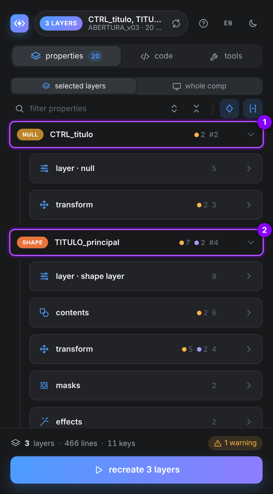</td>
    <td>

**1** **2** · **several layers** → each selected layer gets a header with its type, counts and its own eye. click the header to open or close it.

  </td>
  </tr>
</table>

hover any button or row to see its **tip**: what it does and, when there is one, its shortcut. on properties, the tip shows the internal After Effects name, the keyframes and the start of the expression.

<p align="center">
  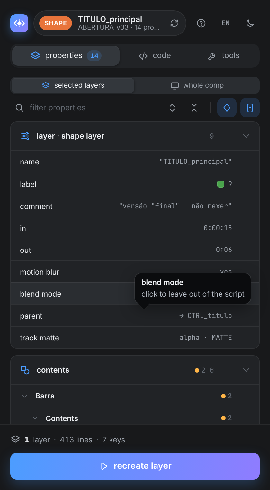
</p>

<br>

---

## 4 · whole comp

in **whole comp** mode, BIN captures the active comp with all its layers and also the **precomps** used inside it, at any depth. the generated script creates the comps in the project, from the innermost to the main one, and links each precomp layer to the freshly created comp.

<table>
  <tr>
    <td width="300">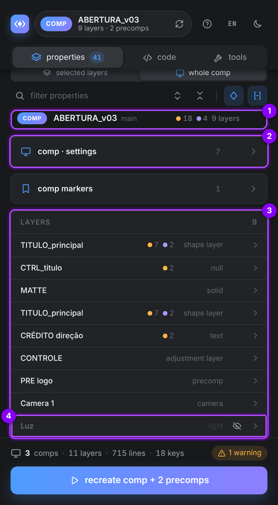</td>
    <td>

1. **main comp** → always goes into the script. the precomps show up below, each with its own header and eye.
2. **settings** → size, duration and frame rate, plus whatever differs from the default: background color, work area, motion blur, shutter, renderer…
3. **layers** → one row per layer, with keyframe and expression marks and the type. click to open the details.
4. **layer left out of the script** → the eye, on hover, leaves the layer out.

**leave a precomp out** (the eye on its header) to not recreate it: the layers that use it look for the original comp in the project by name, and the precomps only it used are left out too.

  </td>
  </tr>
</table>

<table>
  <tr>
    <td width="300">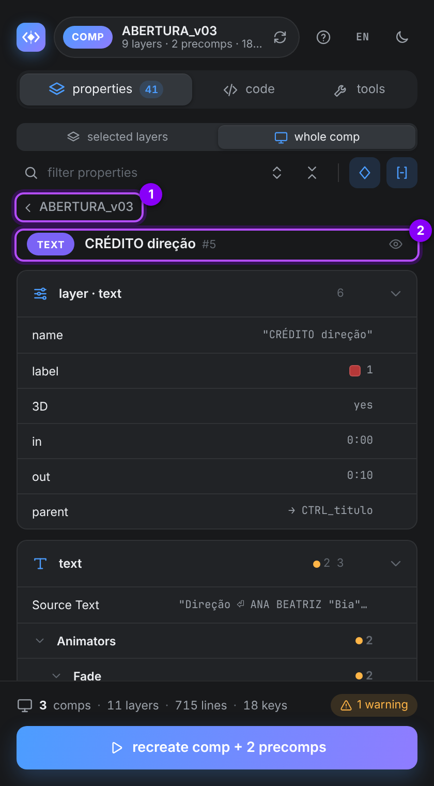</td>
    <td>

1. **back** → returns to the list at the same position (`Esc`).
2. **open layer** → the same layout as layer mode, with the eye to leave the whole layer out.

  </td>
  </tr>
</table>

**essential graphics:** every comp with controls in Essential Graphics gets the **essential graphics** card (with the template name), listing the controls in panel order and where each one comes from (`CONTROLE › Slider`). the script recreates the controls with the same names, in the same order, plus the template name. on precomp layers, the **essential properties** card shows the values changed there (different from the value inside the precomp) and the expressions (marked with **ƒ**), and the script applies them to the recreated layer; the expressions go in at the end, like the others. as with everything else, the eye leaves a control or the whole card out; if the source layer of a control leaves the script, the control goes too and the panel warns about it.

> needs After Effects 2022 or newer to know where each control comes from. to read the controls of a comp that isn't inside any other, BIN creates a temporary comp and deletes it right after (this shows up in the undo history). Essential Graphics groups are not recreated: After Effects doesn't allow creating them by script, so the controls go in ungrouped.

<br>

---

## 5 · the generated code

<table>
  <tr>
    <td width="300">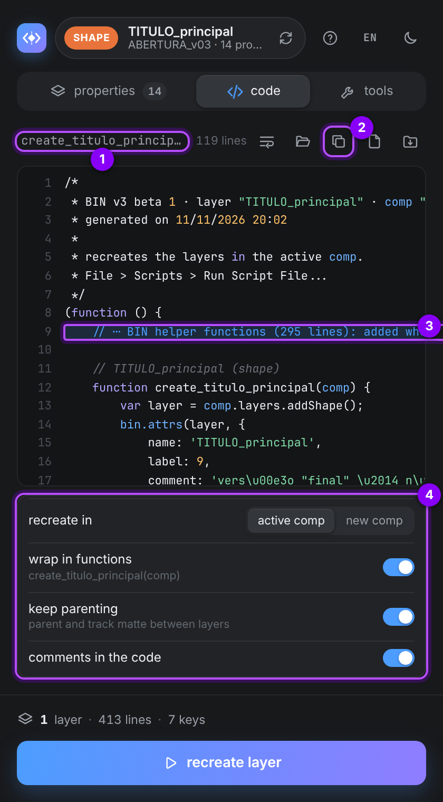</td>
    <td>

1. **file** → suggested name for exporting and line count.
2. **copy and export** → `Ctrl/⌘ + Shift + C` copies, `Ctrl/⌘ + S` saves the `.jsx`.

next to copy and export is the **documentation pack**: a `.json` with the capture, the script and the padeiro template files, for [BIN docs](#-documenting-padeiro-templates).
3. **helper functions** → collapsed into a single line; they come back in full when running, copying and exporting.
4. **options** → see the table below.

  </td>
  </tr>
</table>

| option | what it does |
|---|---|
| **recreate in** | layers mode only. `active comp` uses the comp that is open when the script runs. `new comp` creates a comp just like the source one (settings and markers). in comp mode, the script always creates the comps. |
| **wrap in functions** | one `create_layer_name(comp)` function per layer, easy to reuse (in comp mode, plus one `create_comp_name()` per comp). off, it generates straight code. |
| **keep parenting** | redoes parent and track matte. if the parent wasn't captured too, the script looks for a layer with the same name in the comp. |
| **comments in the code** | separates the blocks with comments. |

the code tab is an **editor**: you can tweak the generated code before running it. from the first edit on, a note reminds you that changes to properties and options no longer reach the code, and **discard edits** goes back to the generated code.

<table>
  <tr>
    <td align="center">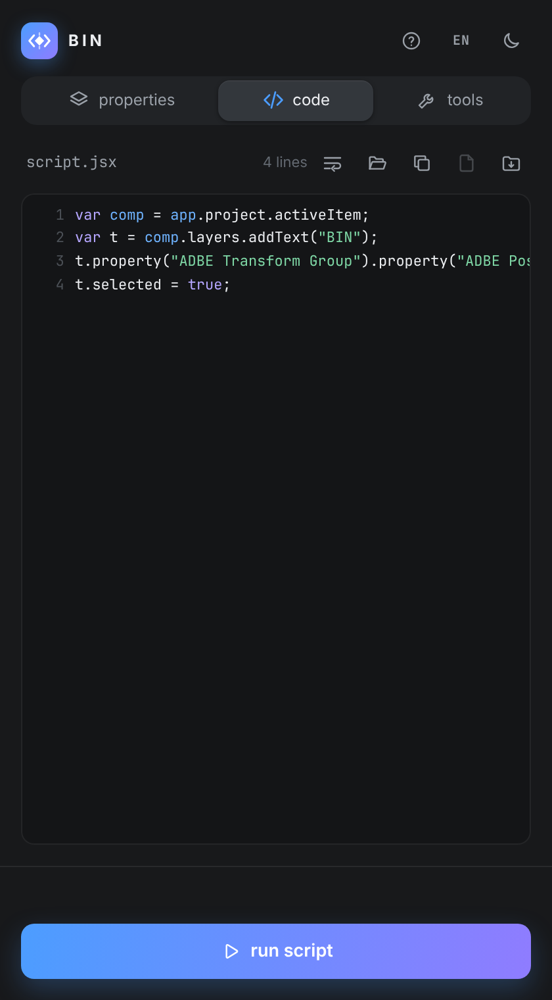<br><sub>free script, no capture</sub></td>
    <td align="center">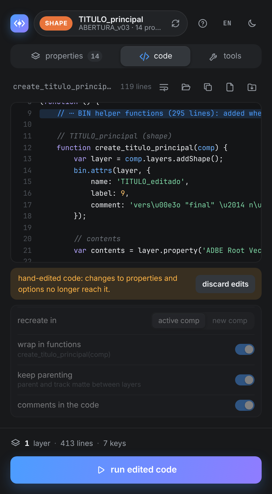<br><sub>hand-edited generated code</sub></td>
  </tr>
</table>

with no capture, the editor becomes a **free scratchpad**: type any After Effects script (ExtendScript) and run it with **run script** or `Ctrl/⌘ + Enter`. the scratchpad is saved in the panel, and the panel opens on the last tab used. on the start screen, **or type a script in the code tab** takes you straight there. every script runs inside a single undo, and an error shows the right line in the editor (with a **go to line** button).

to open an existing script, **drag the file** (`.jsx`, `.js`, `.jsxinc` or `.txt`) anywhere onto the panel, outside the binary area in tools, or use the **open script** button in the code bar (`Ctrl/⌘ + O`). with a capture, the opened script becomes edited code (and **discard edits** goes back to the generated one). UTF-8 and Windows-1252 files open with the right accents.

the generated script is **standalone**: it runs from `File` > `Scripts` > `Run Script File...` in any project, without the panel. it carries a small `bin` object with helper functions that apply each property separately. if a property doesn't exist in the target After Effects version, it is skipped and listed at the end, without bringing down the rest. **expressions go in last**, once all layers and comps exist: none is evaluated before its dependencies (which would leave stuck errors, as in the expression selector). effect parameters that point to a layer (3D Glasses, Displacement Map…) are also resolved at the end, to the recreated layer.

```js
function create_titulo_principal(comp) {
	var layer = comp.layers.addShape();
	bin.attrs(layer, { name: 'TITULO_principal', label: 9 });

	// contents
	var contents = layer.property('ADBE Root Vectors Group');
	var barra = bin.add(contents, 'ADBE Vector Group', 'Barra');
	var rectanglePath1 = bin.add(barra.property('ADBE Vectors Group'), 'ADBE Vector Shape - Rect', 'Rectangle Path 1');
	bin.keys(rectanglePath1.property('ADBE Vector Rect Size'), [
		{ t: 0, v: [0, 120], i: 'BB', ei: [[0, 33], [0, 33]], eo: [[0, 75], [0, 75]] },
		{ t: 0.5338, v: [860, 120], i: 'BL' }
	]);

	// transform
	var transform = layer.property('ADBE Transform Group');
	bin.expr(transform.property('ADBE Rotate Z'), [
		'var amp = thisComp.layer("CONTROLE").effect("amp")("Slider");',
		'wiggle(2, amp);'
	].join('\n'));
	return layer;
}
```

<br>

---

## 6 · recreate, copy and export

<table>
  <tr>
    <td width="300">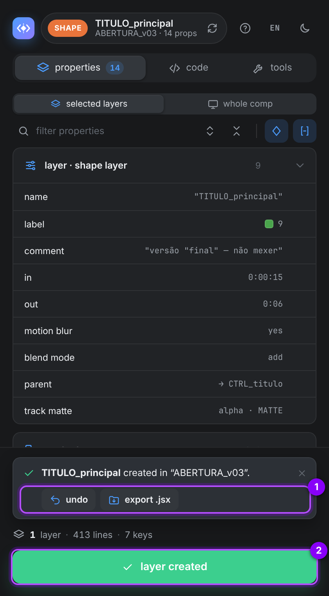</td>
    <td>

1. **undo and export** → the completion notice offers to undo everything at once and to export the `.jsx` that just ran.
2. **recreate** → runs the script right away, inside a single undo (`Ctrl/⌘ + Enter`). it turns green when done.

the exported file is saved as UTF-8 with BOM, which ExtendScript reads with the right accents on any system.

  </td>
  </tr>
</table>

<table>
  <tr>
    <td width="300">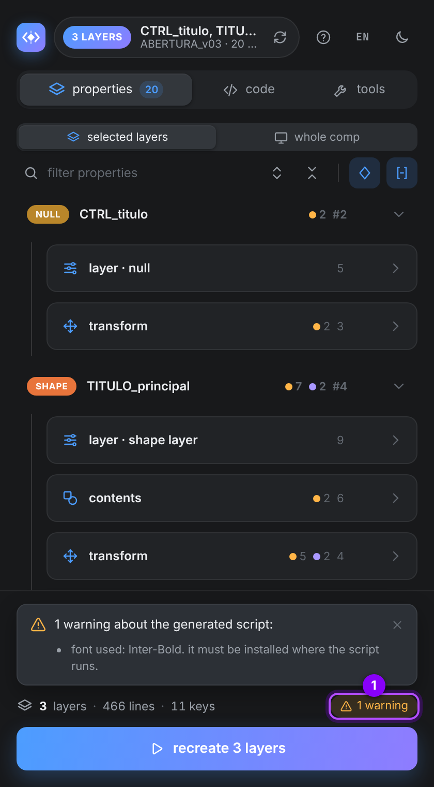</td>
    <td>

1. **warnings** → what may differ on another computer: fonts, third-party plug-ins, footage and precomps looked up in the project by name. hover to see the list; click to see everything.

  </td>
  </tr>
</table>

<table>
  <tr>
    <td width="300">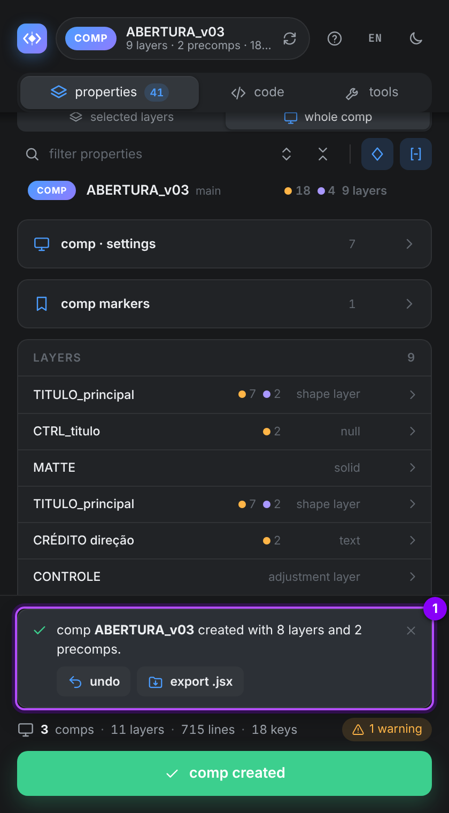</td>
    <td>

1. **comp recreated** → in comp mode, the notice says how many layers and precomps were created, and the new comp opens in the viewer.

  </td>
  </tr>
</table>

### ⌨️ shortcuts

with the panel focused:

| shortcut | what it does |
|---|---|
| `1` `2` `3` | properties, code and tools tabs |
| `Ctrl/⌘ + L` | update the capture (current selection or active comp) |
| `Ctrl/⌘ + F` | filter properties |
| `Ctrl/⌘ + Enter` | recreate (or run the script in the code tab) |
| `Tab` (in the editor) | inserts a tab |
| `Ctrl/⌘ + O` | open a script in the editor |
| `Ctrl/⌘ + S` | export .jsx |
| `Ctrl/⌘ + Shift + C` | copy the code |
| `Esc` | clears the filter, goes back from the open layer or closes the notice |

with the panel focused, these keys go to BIN instead of the After Effects shortcuts (like **Quick Apply** on `⌘ + Enter`). on the Mac, `⌃ Control` also works instead of `⌘`. tooltips show the symbol next to the key name (`⌘ Cmd`, `⇧ Shift`).

### 🌐 languages

BIN speaks **Portuguese, English and Spanish**: the panel, tips and notices, the messages from After Effects, the generated script (comments, function names — `criar_…`, `create_…`, `crear_…` — and error messages) and the installer. the first time, it follows the After Effects language; after that, the **PT / EN / ES** button at the top of the panel switches it (and remembers). the installer follows the After Effects language.

the texts live in [`bin-cep/i18n/textos.csv`](bin-cep/i18n/textos.csv): one row per text and one column per language (`pt,en,es`). the `pt` column is the key (the code stays written in Portuguese); variable parts use `{0}`, `{1}`… and line breaks are written as `\n`. to fix a translation, edit the cell; for a new language, add a column (and its code in `LANGS`, in `bin-cep/js/i18n.js`). the `tests/i18n_check.js` test checks that every text in the code is in the CSV, with the same `{0}` in each language, and that the panel in English and Spanish shows nothing in Portuguese.

**version:** the logo tooltip shows the name (`BIN v3 beta 1`) and the signature of the installed files (e.g. `version 611f0c31`). when it opens, the panel reloads the part that talks to After Effects (`host.jsx`) from its own folder, so an update applies in full even without restarting AE (just close and reopen the panel).

<br>

---

## 7 · tools

**property path** → select one or more properties (or groups) in the timeline (an effect parameter, a shape path, the position, a mask, Source Text, an essential property…) and click **get from selection**. for each one, BIN shows the readable path (`ABERTURA_v03 › TITULO_principal › Effects › Glow › Glow Radius`) and the paths ready to copy:

| | example |
|---|---|
| absolute expression (with the comp) | `comp("ABERTURA_v03").layer("TITULO_principal").effect("Glow")("Glow Radius")` |
| expression relative to the comp | `thisComp.layer("TITULO_principal").effect("Glow")("Glow Radius")` |
| expression relative to the layer | `effect("Glow")("Glow Radius")` |
| expression by matchName (works in any AE language) | `comp("ABERTURA_v03").layer("TITULO_principal")("ADBE Effect Parade")("Glow")("ADBE Glo2-0002")` |
| absolute script (comp by its position in the project) | `app.project.item(4).layer("TITULO_principal").property("ADBE Effect Parade").property("Glow").property("ADBE Glo2-0002")` |
| script relative to the layer | `layer.property("ADBE Effect Parade").property("Glow").property("ADBE Glo2-0002")` |

the expressions use After Effects’ shortcuts (`transform.position`, `mask("…").maskPath`, `content("…").content("…").size`, `text.sourceText`, `essentialProperty("…")`).

<table>
  <tr>
    <td width="300">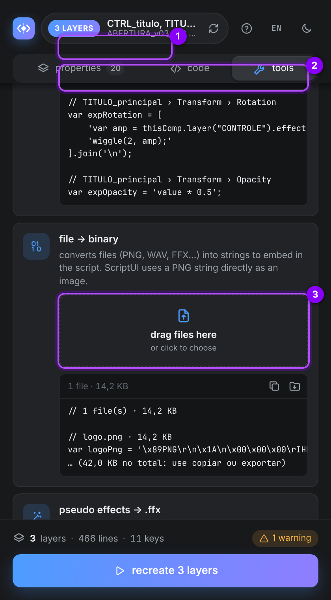</td>
    <td>

1. **expression → string** → takes the expression of the selected property; with a group selected (an effect, the transform…), the expressions inside it; with nothing selected inside the layer, all of its expressions…
2. … and formats it as a JS string, one line per item, ready to paste into a script. copy or export from the bar.
3. **file → binary** → drag files (PNG, WAV, FFX…) or click to choose (up to 20 MB in total: the string is about 4 times larger than the file). BIN generates a variable with each file’s content, plus a `binToFile()` function to write it back to disk. in ScriptUI, a PNG string works directly as an image.
4. **pseudo effects → .ffx** → every pseudo effect in the capture (matchName `Pseudo/…`) gets a **save .ffx** button: BIN selects just that effect on the original layer and opens After Effects’ *Save Animation Preset*. the file is AE’s own and carries the effect definition. saved in the default folder (User Presets), BIN finds it by itself; saved elsewhere, use **choose .ffx**. the .ffx is embedded in the generated script: on a machine without the effect in PresetEffects.xml, the script applies the .ffx in a temporary comp to register the effect, deletes the comp and creates the effect normally. BIN remembers the .ffx of each pseudo effect. when you capture a layer or comp with pseudo effects that have no .ffx yet, BIN offers to save them (**save .ffx**, or **save all N**, one dialog at a time); in the properties tab, the pseudo effect row has a **.ffx** badge (green when it goes into the script; click to save).

  </td>
  </tr>
</table>

<table>
  <tr>
    <td width="300">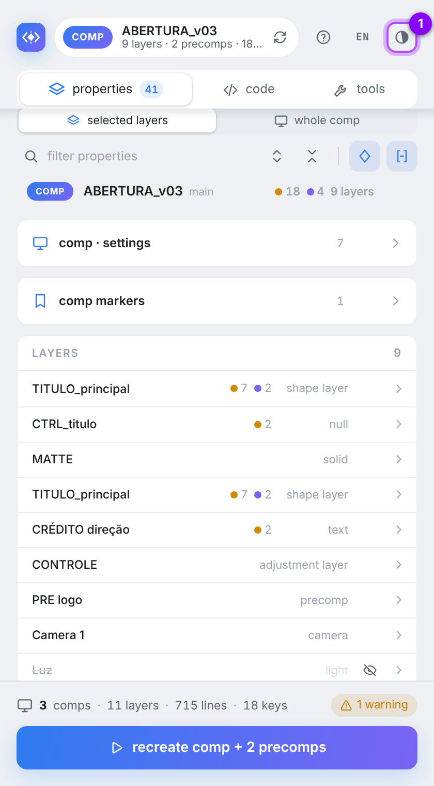</td>
    <td>

1. **theme** → switches between automatic (follows the brightness of the After Effects interface), light and dark.

  </td>
  </tr>
</table>

<br>

---


## 📚 documenting padeiro templates

**[BIN docs](docs-app/README.md)** (in Portuguese) is a web app that turns BIN’s documentation pack, together with screenshots of the controls, into a documentation draft written by an agent (an n8n workflow with OpenAI). you review it, ask for changes and export the `.md` (or a `.zip` with the images, for AFFiNE). its interface is in Portuguese only.

<p align="center">
  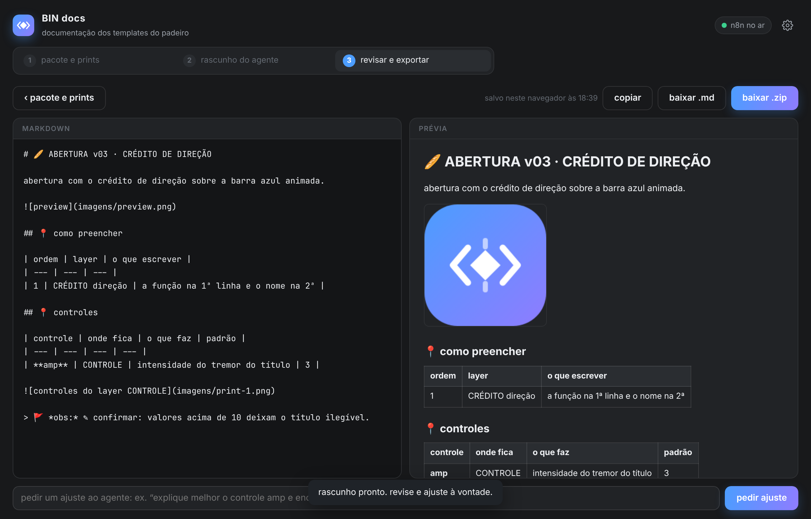
</p>

<br>

---

## 🧩 what gets recreated

| | |
|---|---|
| **layer types** | shape, text (point and box), solid, adjustment, null, camera, light, precomp and footage (looked up in the project by name; footage is reimported from the original path if it exists) |
| **attributes** | name, label, comment, in / out, start, stretch, 3D, motion blur, blend mode, quality, guide, shy, auto-orient, time remap, locked… |
| **properties** | values (whatever went back to the transform default, like 100% scale, is left out), keyframes (interpolation, easing, spatial tangents, continuity, auto-bezier, roving), expressions (including disabled ones), position with separate dimensions |
| **groups** | shape groups and all their items, effects (including disabled ones), masks (mode, inverted, feather, color), text animators with selectors |
| **text** | font, size, color, stroke, alignment, tracking, leading, text box and, on AE 24.3+, different styles per range |
| **markers** | comment, duration, label, chapter, URL, cue point and parameters |
| **between layers** | parent (without jumping the position) and track matte |
| **comps** | size, duration, frame rate, background color, timecode start, work area, motion blur and shutter, frame blending, shy, draft 3D, renderer, label, comment, markers and nested precomps |
| **pseudo effects** | recreated with their values; with the .ffx saved in the tools tab, also on machines without the effect in `PresetEffects.xml` (without the .ffx, the script warns and goes on with the rest) |
| **essential graphics** | the comp’s controls (name, order and where they come from), the template name and, on precomp layers, the changed values and the expressions (including disabled ones) of the essential properties |

**not recreated:** layer styles (the After Effects API doesn’t allow adding them), effect masks and Essential Graphics groups. the panel warns when the layer uses any of them.

<br>

---

## 🛠 development

```
bin-cep/
  CSXS/manifest.xml   com.jmbillard.bin · AE 17.0+
  index.html · css/style.css
  i18n/textos.csv     texts in pt, en and es
  js/cep.js           bridge to After Effects and the disk
  js/i18n.js          translations (reads textos.csv)
  js/ui.js            icons, tips and notices
  js/codegen.js       capture → script (no DOM: also runs in Node)
  js/app.js           the panel
  jsx/host.jsx        layer capture (read-only) and execution
  icons/              tab icons
tests/                tests, the simulated After Effects and the screenshot generators
```

```bash
node tests/roundtrip.js      # round trip: every layer type and a comp with nested precomps
node tests/run_panel.js      # panel end to end + screenshots in tests/out
node tests/i18n_check.js     # translations: complete CSV, generated script and panel in English and Spanish
node tests/installer_preview.js docs/img/en en  # runs the installer in a simulated ScriptUI and draws each step
node tests/make_docs.js en   # README screenshots with numbered marks (docs/img/en)
node tests/make_demo.js en   # records the simulated use and generates docs/img/en/demo.gif (needs ffmpeg)
```

to debug the panel inside After Effects, with `PlayerDebugMode` on, open `http://localhost:8098` in Chrome.
