<p align="center">
  
</p>

# BIN

🌐 [português](README.md) · [English](README.en.md) · **español**

🗨️ **v3 beta 1** ⚡ extensión de After Effects para **ingeniería inversa de capas** ⚡

**BIN** lee las capas seleccionadas (o una **comp entera**, con sus precomps) y genera un script **.jsx** que lo recrea todo desde cero, en cualquier proyecto: propiedades, keyframes con easing y tangentes, expresiones, efectos, máscaras, formas, textos, marcadores, emparentado, track matte y los ajustes de la comp.

Sirve para convertir un layout terminado en una herramienta: el script generado puede ser un botón de otro panel, una plantilla o un trozo de automatización.

<p align="center">
  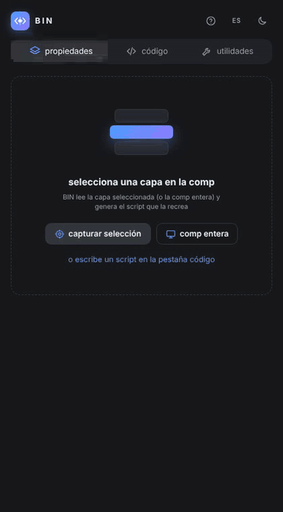<br>
  <sub>el panel en acción: capturar, quitar una propiedad y un efecto, ver el código, recrear y la comp entera.</sub>
</p>

> 📂 **archivos:**\
> • **INSTALAR O BIN.jsx** → instalador (se ejecuta dentro de After Effects; el nombre está en portugués: “instalar BIN”).\
> • **bin-cep/** → la extensión (panel CEP).\
> • **instalar_windows.bat** / **instalar_mac.command** → instaladores alternativos, sin abrir After Effects.

<br>

## 📑 índice

1. [instalar](#1--instalar)
2. [capturar](#2--capturar)
3. [elegir qué entra en el script](#3--elegir-qué-entra-en-el-script)
4. [comp entera](#4--comp-entera)
5. [el código generado](#5--el-código-generado)
6. [recrear, copiar y exportar](#6--recrear-copiar-y-exportar)
7. [utilidades](#7--utilidades)
8. [qué se recrea](#-qué-se-recrea)
9. [desarrollo](#-desarrollo)

<br>

---

## 1 · instalar

> ✅ **requisitos:** After Effects **2020 (17.0)** o posterior.

**1.1** en After Effects, abre `File` > `Scripts` > `Run Script File...` y elige **INSTALAR O BIN.jsx** directamente desde la carpeta de BIN (la que tiene `bin-cep` dentro).

**1.2** el instalador comprueba lo necesario. si la escritura de archivos está bloqueada, usa el enlace **› abrir preferencias de scripts y expresiones**, marca *Allow Scripts to Write Files and Access Network* y haz clic en **› comprobar de nuevo**.

<table>
  <tr>
    <td align="center">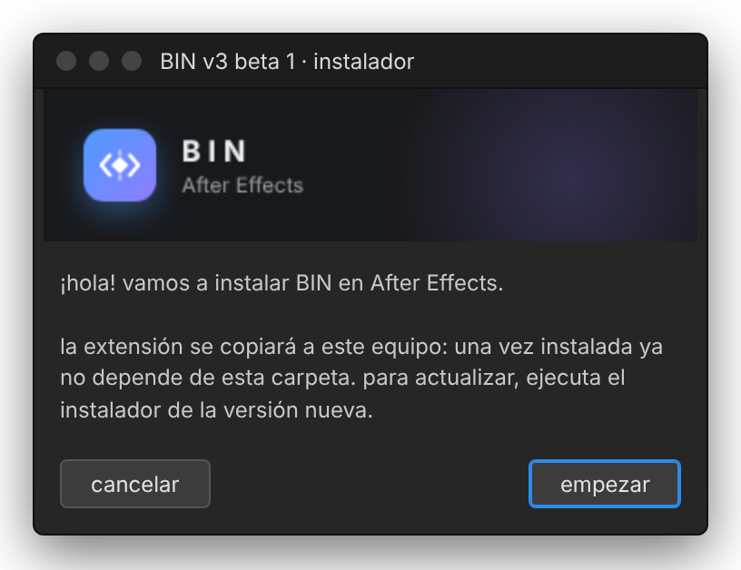<br><sub>1.1 · bienvenida</sub></td>
    <td align="center">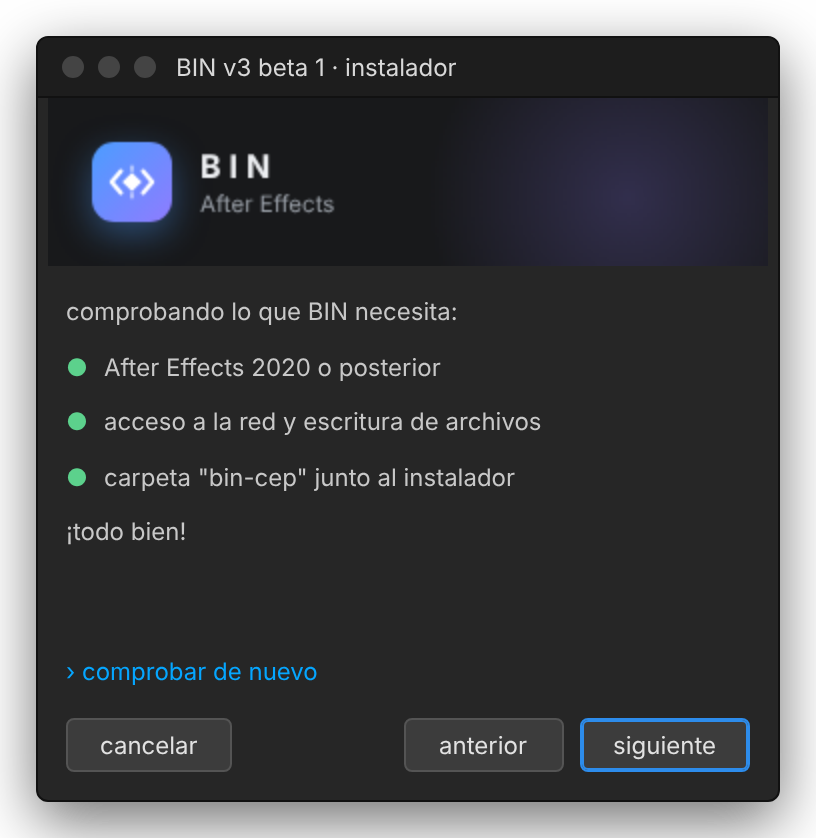<br><sub>1.2 · comprobaciones</sub></td>
  </tr>
</table>

si todo está bien, **empezar** salta las comprobaciones y va directo a instalar / actualizar (las comprobaciones siguen a un clic, en **anterior**). si algo falla, el instalador se detiene ahí y explica qué resolver.

**1.3** elige **instalar** (o **actualizar** / **reinstalar**; **quitar** desinstala) y **reinicia After Effects**.

<table>
  <tr>
    <td align="center">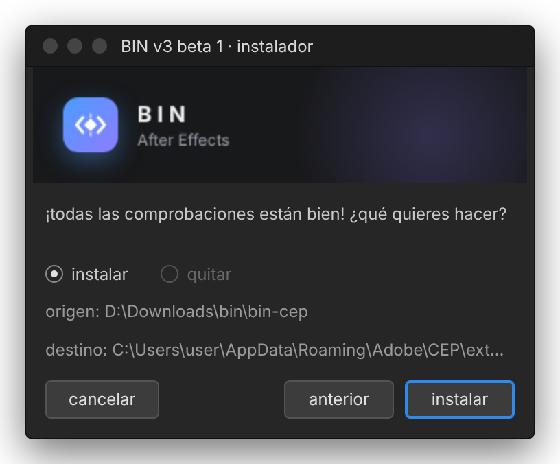<br><sub>1.3 · acción</sub></td>
    <td align="center">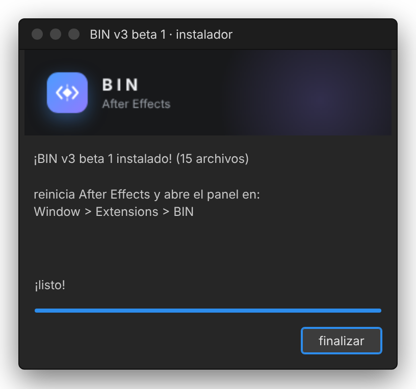<br><sub>1.3 · listo</sub></td>
  </tr>
</table>

**1.4** abre el panel en `Window` > `Extensions` > `BIN`.

> 💡 sin abrir After Effects: ejecuta **instalar_windows.bat** (Windows) o **instalar_mac.command** (macOS). los dos hacen la misma copia y habilitan extensiones sin firma (`PlayerDebugMode`).

<br>

---

## 2 · capturar

abre el panel en `Window` > `Extensions` > `BIN`. se puede acoplar en cualquier lugar del espacio de trabajo, como los demás paneles.

<table>
  <tr>
    <td width="300">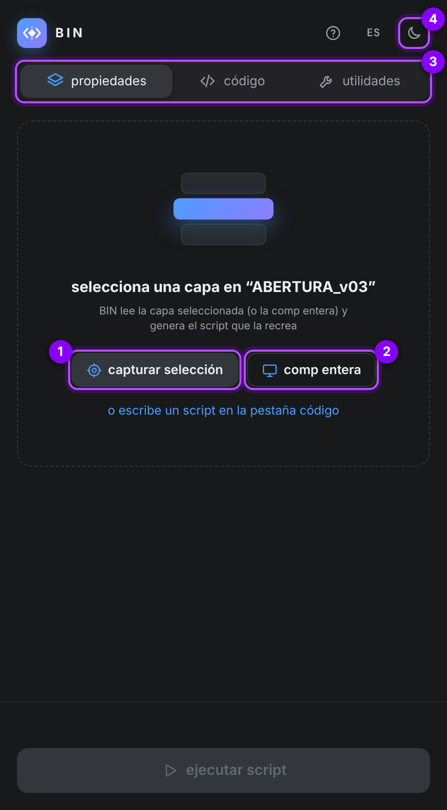</td>
    <td>

1. **capturar selección** → lee las capas seleccionadas en la comp activa.
2. **comp entera** → lee la comp activa con todas sus capas y precomps. mira la [sección 4](#4--comp-entera).
3. **pestañas** → `propiedades`, `código` y `utilidades` (atajos `1` `2` `3`).
4. **tema** → automático (sigue a After Effects), claro u oscuro.

  </td>
  </tr>
</table>

la captura es de **solo lectura**: nada en el proyecto cambia y el historial de deshacer queda limpio.

<br>

---

## 3 · elegir qué entra en el script

<table>
  <tr>
    <td width="300">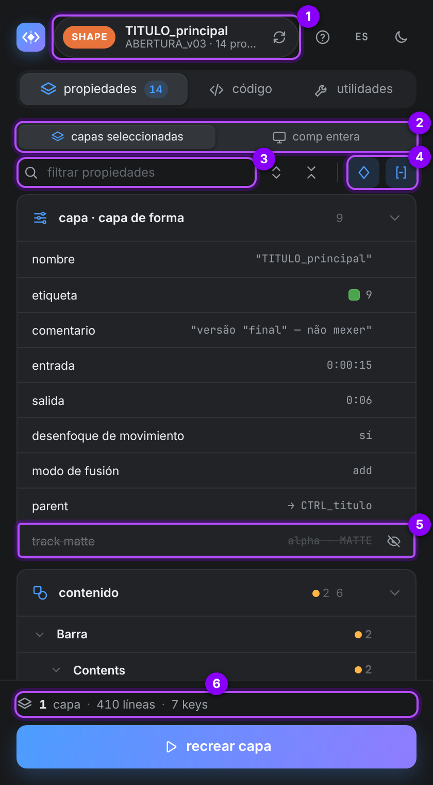</td>
    <td>

1. **chip** → tipo de capa (`SHAPE`, `TEXTO`, `SÓLIDO`, `NULL`, `AJUSTE`, `CÁM`, `LUZ`, `COMP`, `MEDIOS`), comp de origen y conteos. haz clic (o `Ctrl/⌘ + L`) para actualizar la captura. el panel sigue la selección en After Effects: cuando cambia (o, en el modo comp entera, cuando otra comp queda activa), el chip se destaca y muestra **actualizar a “…”**, sin recapturar solo y sin mover el resto del panel. en la pantalla inicial, el botón ya dice qué se va a capturar.
2. **modo** → `capas seleccionadas` o `comp entera`. al cambiar, captura de nuevo.
3. **filtrar** → por nombre de propiedad, grupo o capa (`Ctrl/⌘ + F`).
4. **keyframes y expresiones** → se activan y desactivan en todo el script. sin keyframes, cada propiedad recibe el valor de su primer keyframe.
5. **fila fuera del script** → haz clic en la fila para quitar la propiedad; queda tachada. haz clic otra vez para devolverla.
6. **resumen** → capas, líneas del script y keyframes que entran.

  </td>
  </tr>
</table>

solo aparecen las propiedades **modificadas**: distintas del valor por defecto, con keyframes o con expresión. los **rombos** amarillos son keyframes y la **ƒ** violeta es una expresión.

<table>
  <tr>
    <td width="300">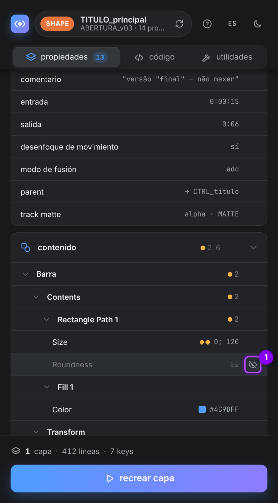</td>
    <td>

1. **ojo** → aparece al pasar el ratón. en las propiedades, toda la fila es clicable; en grupos, tarjetas y capas, el ojo quita el grupo entero (un efecto, una máscara, un grupo de forma).

un ojo azul fijo en un grupo **cerrado** avisa que una parte está fuera del script.

  </td>
  </tr>
</table>

<table>
  <tr>
    <td width="300">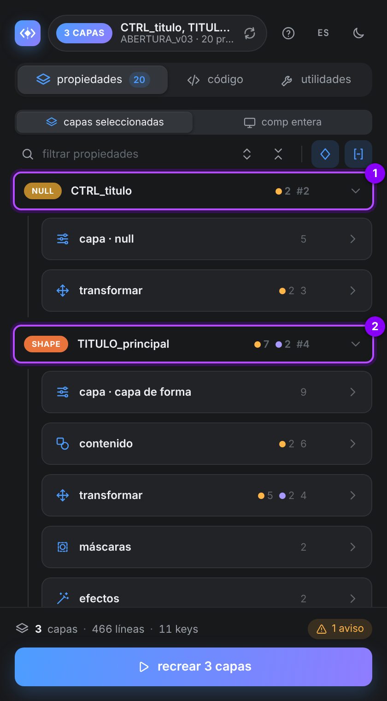</td>
    <td>

**1** **2** · **varias capas** → cada capa seleccionada tiene una cabecera con el tipo, los conteos y su propio ojo. haz clic en la cabecera para abrirla o cerrarla.

  </td>
  </tr>
</table>

pasa el ratón sobre cualquier botón o fila para ver la **sugerencia**: qué hace y, si lo hay, el atajo. en las propiedades, la sugerencia muestra el nombre interno en After Effects, los keyframes y el inicio de la expresión.

<p align="center">
  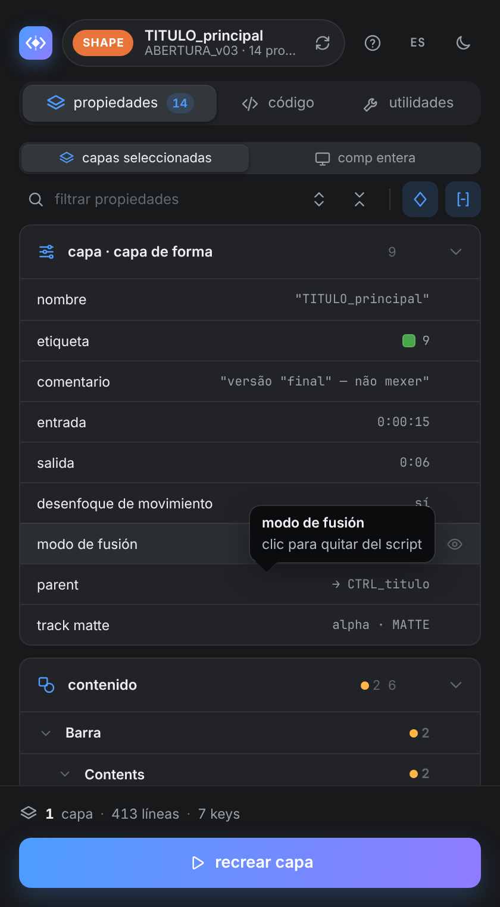
</p>

<br>

---

## 4 · comp entera

en el modo **comp entera**, BIN captura la comp activa con todas sus capas y también las **precomps** usadas dentro, a cualquier profundidad. el script generado crea las comps en el proyecto, de las más internas a la principal, y enlaza cada capa de precomp con la comp recién creada.

<table>
  <tr>
    <td width="300">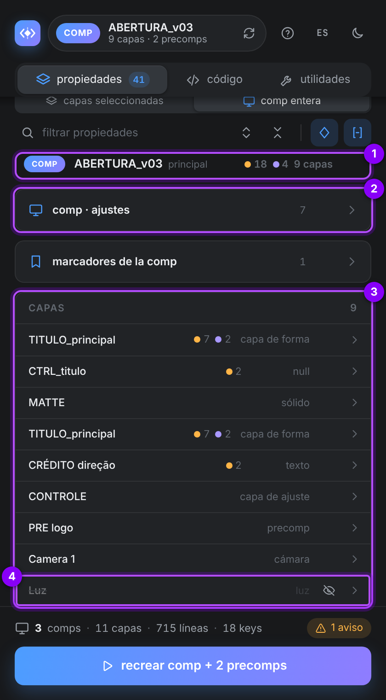</td>
    <td>

1. **comp principal** → siempre entra en el script. las precomps aparecen debajo, cada una con su cabecera y su ojo.
2. **ajustes** → tamaño, duración y velocidad de fotogramas, más lo que sea distinto del valor por defecto: color de fondo, área de trabajo, desenfoque de movimiento, obturador, procesador…
3. **capas** → una fila por capa, con las marcas de keyframes y expresiones y el tipo. haz clic para abrir el detalle.
4. **capa fuera del script** → el ojo, al pasar el ratón, quita la capa.

**quita una precomp** (el ojo en su cabecera) para no recrearla: las capas que la usan buscan la comp original en el proyecto por nombre, y las precomps que solo ella usaba salen también.

  </td>
  </tr>
</table>

<table>
  <tr>
    <td width="300">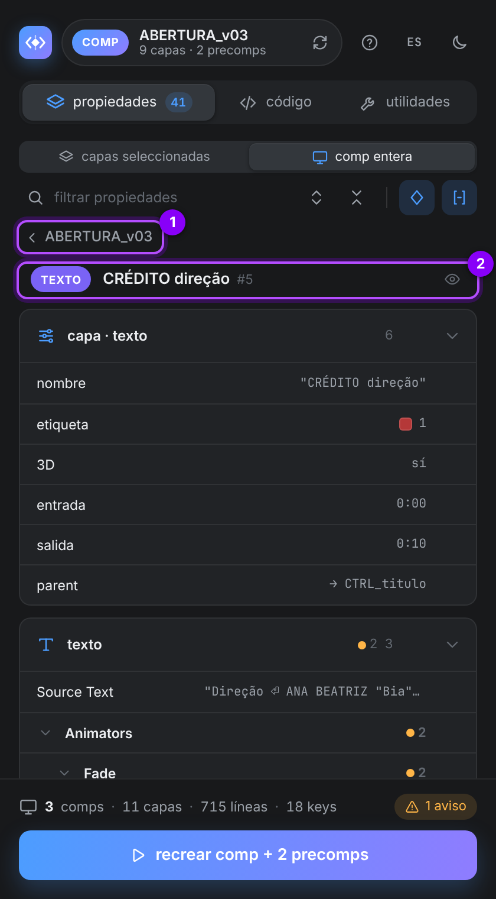</td>
    <td>

1. **volver** → regresa a la lista en la misma posición (`Esc`).
2. **capa abierta** → el mismo formato del modo capas, con el ojo para quitar la capa entera.

  </td>
  </tr>
</table>

**essential graphics:** cada comp con controles en Essential Graphics tiene la tarjeta **essential graphics** (con el nombre de la plantilla), que lista los controles en el orden del panel y de dónde viene cada uno (`CONTROLE › Slider`). el script recrea los controles con los mismos nombres, en el mismo orden, y el nombre de la plantilla. en las capas de precomp, la tarjeta **essential properties** muestra los valores cambiados allí (distintos del valor dentro de la precomp) y las expresiones (marcadas con **ƒ**), y el script los aplica a la capa recreada; las expresiones entran al final, como las demás. como todo lo demás, el ojo quita un control o la tarjeta entera; si la capa de origen de un control sale del script, el control sale también y el panel avisa.

> requiere After Effects 2022 o posterior para saber de dónde viene cada control. para leer los controles de una comp que no está dentro de ninguna otra, BIN crea una comp temporal y la borra enseguida (esto aparece en el historial de deshacer). los grupos de Essential Graphics no se recrean: After Effects no permite crearlos por script, así que los controles entran sueltos.

<br>

---

## 5 · el código generado

<table>
  <tr>
    <td width="300">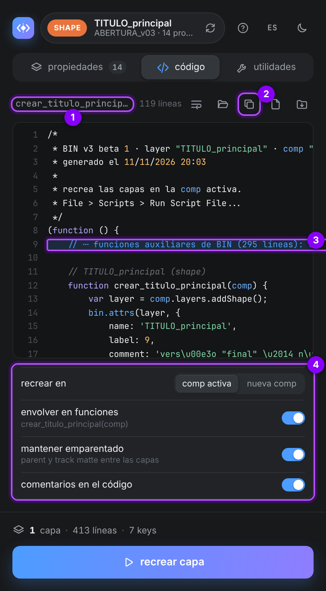</td>
    <td>

1. **archivo** → nombre sugerido para exportar y cantidad de líneas.
2. **copiar y exportar** → `Ctrl/⌘ + Shift + C` copia, `Ctrl/⌘ + S` guarda el `.jsx`.

junto a copiar y exportar está el **paquete de documentación**: un `.json` con la captura, el script y los archivos de la plantilla de padeiro, para [BIN docs](#-documentar-plantillas-de-padeiro).
3. **funciones auxiliares** → recogidas en una sola línea; vuelven enteras al ejecutar, copiar y exportar.
4. **opciones** → mira la tabla de abajo.

  </td>
  </tr>
</table>

| opción | qué hace |
|---|---|
| **recrear en** | solo en el modo capas. `comp activa` usa la comp abierta cuando se ejecuta el script. `nueva comp` crea una comp igual a la de origen (ajustes y marcadores). en el modo comp, el script siempre crea las comps. |
| **envolver en funciones** | una función `crear_nombre_de_la_capa(comp)` por capa, fácil de reutilizar (en el modo comp, además una `crear_comp_nombre()` por comp). desactivado, genera el código corrido. |
| **mantener emparentado** | rehace parent y track matte. si el parent no se capturó junto, el script busca una capa con el mismo nombre en la comp. |
| **comentarios en el código** | separa los bloques con comentarios. |

la pestaña código es un **editor**: puedes retocar el código generado antes de ejecutarlo. desde la primera edición, un aviso recuerda que los cambios en las propiedades y opciones ya no llegan al código, y **descartar ediciones** vuelve al código generado.

<table>
  <tr>
    <td align="center">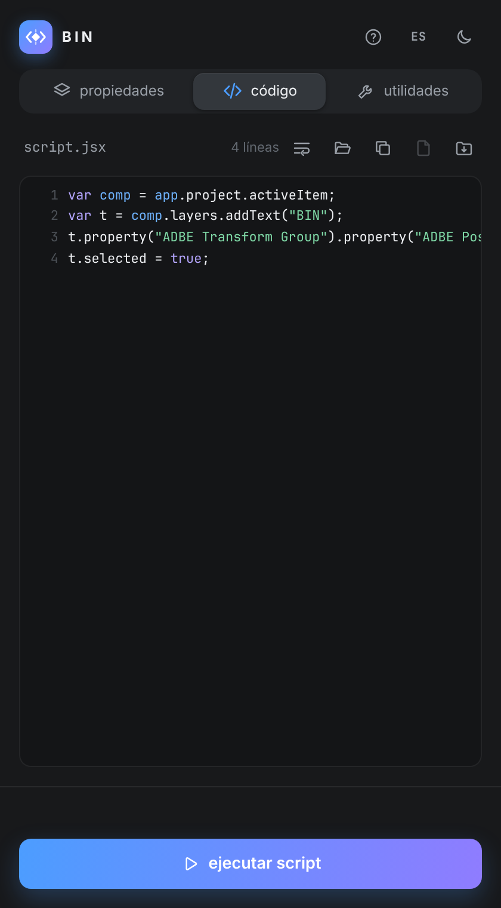<br><sub>script libre, sin captura</sub></td>
    <td align="center">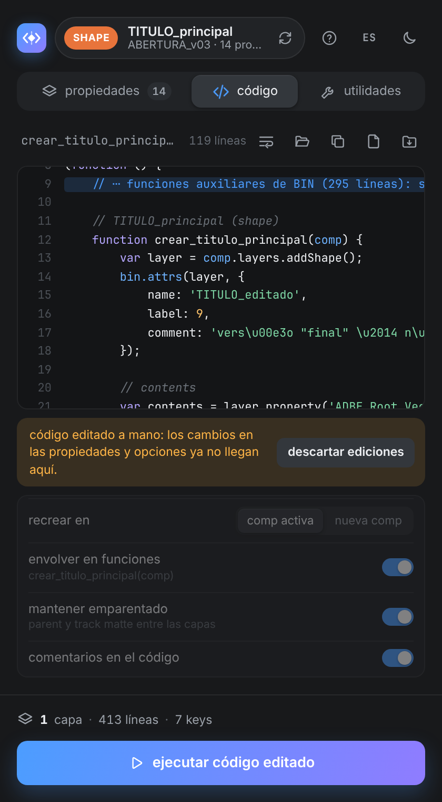<br><sub>código generado editado a mano</sub></td>
  </tr>
</table>

sin ninguna captura, el editor es un **borrador libre**: escribe cualquier script de After Effects (ExtendScript) y ejecútalo con **ejecutar script** o `Ctrl/⌘ + Enter`. el borrador queda guardado en el panel, y el panel abre en la última pestaña usada. en la pantalla inicial, **o escribe un script en la pestaña código** lleva directo allí. todo script se ejecuta dentro de un solo deshacer, y un error muestra la línea correcta del editor (con el botón **ir a la línea**).

para abrir un script existente, **arrastra el archivo** (`.jsx`, `.js`, `.jsxinc` o `.txt`) a cualquier lugar del panel, fuera del área de binario en utilidades, o usa el botón **abrir script** de la barra del código (`Ctrl/⌘ + O`). con una captura, el script abierto entra como código editado (y **descartar ediciones** vuelve al generado). los archivos en UTF-8 o Windows-1252 se abren con los acentos correctos.

el script generado es **autónomo**: se ejecuta desde `File` > `Scripts` > `Run Script File...` en cualquier proyecto, sin el panel. lleva un pequeño objeto `bin` con funciones auxiliares que aplican cada propiedad por separado. si una propiedad no existe en la versión de After Effects de destino, se salta y se lista al final, sin tumbar el resto. las **expresiones entran al final**, cuando ya existen todas las capas y comps: ninguna se evalúa antes de sus dependencias (lo que dejaría errores atascados, como en el expression selector). los parámetros de efecto que apuntan a una capa (3D Glasses, Displacement Map…) también se resuelven al final, con la capa recreada.

```js
function crear_titulo_principal(comp) {
	var layer = comp.layers.addShape();
	bin.attrs(layer, { name: 'TITULO_principal', label: 9 });

	// contents
	var contents = layer.property('ADBE Root Vectors Group');
	var barra = bin.add(contents, 'ADBE Vector Group', 'Barra');
	var rectanglePath1 = bin.add(barra.property('ADBE Vectors Group'), 'ADBE Vector Shape - Rect', 'Rectangle Path 1');
	bin.keys(rectanglePath1.property('ADBE Vector Rect Size'), [
		{ t: 0, v: [0, 120], i: 'BB', ei: [[0, 33], [0, 33]], eo: [[0, 75], [0, 75]] },
		{ t: 0.5338, v: [860, 120], i: 'BL' }
	]);

	// transform
	var transform = layer.property('ADBE Transform Group');
	bin.expr(transform.property('ADBE Rotate Z'), [
		'var amp = thisComp.layer("CONTROLE").effect("amp")("Slider");',
		'wiggle(2, amp);'
	].join('\n'));
	return layer;
}
```

<br>

---

## 6 · recrear, copiar y exportar

<table>
  <tr>
    <td width="300">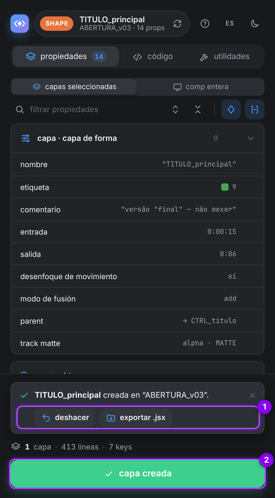</td>
    <td>

1. **deshacer y exportar** → el aviso de finalización ofrece deshacer todo de una vez y exportar el `.jsx` que se acaba de ejecutar.
2. **recrear** → ejecuta el script al momento, dentro de un solo deshacer (`Ctrl/⌘ + Enter`). se pone verde al terminar.

el archivo exportado se guarda en UTF-8 con BOM, que ExtendScript lee con los acentos correctos en cualquier sistema.

  </td>
  </tr>
</table>

<table>
  <tr>
    <td width="300">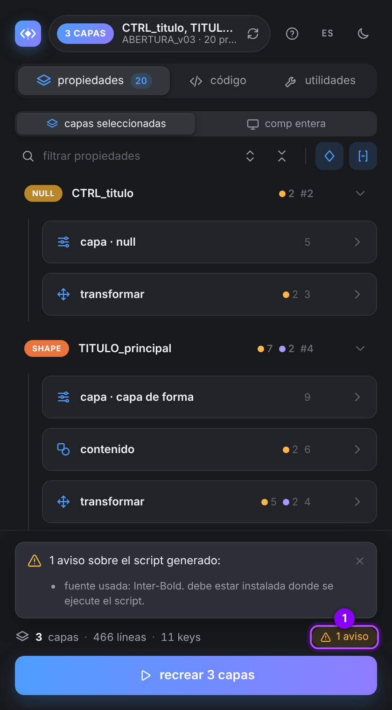</td>
    <td>

1. **avisos** → lo que puede cambiar en otro equipo: fuentes, plug-ins de terceros, material y precomps buscados en el proyecto por nombre. pasa el ratón para ver la lista; haz clic para verlo todo.

  </td>
  </tr>
</table>

<table>
  <tr>
    <td width="300">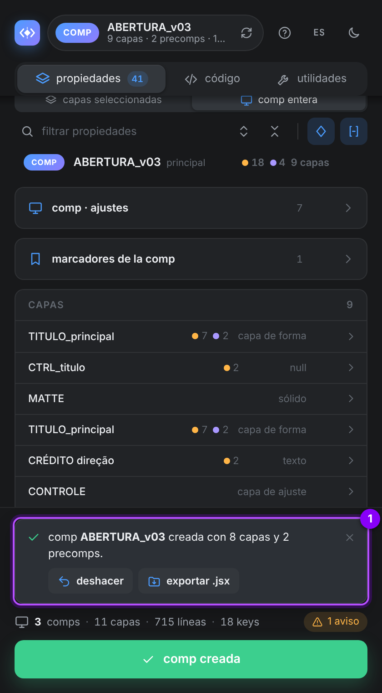</td>
    <td>

1. **comp recreada** → en el modo comp, el aviso dice cuántas capas y precomps se crearon, y la comp nueva se abre en el visor.

  </td>
  </tr>
</table>

### ⌨️ atajos

con el panel enfocado:

| atajo | qué hace |
|---|---|
| `1` `2` `3` | pestañas propiedades, código y utilidades |
| `Ctrl/⌘ + L` | actualizar la captura (selección o comp activa del momento) |
| `Ctrl/⌘ + F` | filtrar propiedades |
| `Ctrl/⌘ + Enter` | recrear (o ejecutar el script de la pestaña código) |
| `Tab` (en el editor) | inserta una tabulación |
| `Ctrl/⌘ + O` | abrir un script en el editor |
| `Ctrl/⌘ + S` | exportar .jsx |
| `Ctrl/⌘ + Shift + C` | copiar el código |
| `Esc` | limpia el filtro, vuelve de la capa abierta o cierra el aviso |

con el panel enfocado, estas teclas van a BIN y no a los atajos de After Effects (como el **Quick Apply** de `⌘ + Enter`). en Mac, `⌃ Control` también sirve en lugar de `⌘`. las sugerencias muestran el símbolo junto al nombre de la tecla (`⌘ Cmd`, `⇧ Shift`).

### 🌐 idiomas

BIN habla **portugués, inglés y español**: el panel, las sugerencias y avisos, los mensajes de After Effects, el script generado (comentarios, nombres de las funciones — `criar_…`, `create_…`, `crear_…` — y mensajes de error) y el instalador. la primera vez, sigue el idioma de After Effects; después, el botón **PT / EN / ES** arriba del panel lo cambia (y lo recuerda). el instalador sigue el idioma de After Effects.

los textos están en [`bin-cep/i18n/textos.csv`](bin-cep/i18n/textos.csv): una fila por texto y una columna por idioma (`pt,en,es`). la columna `pt` es la clave (el código sigue escrito en portugués); las partes variables usan `{0}`, `{1}`… y los saltos de línea se escriben como `\n`. para corregir una traducción, edita la celda; para un idioma nuevo, añade una columna (y su código en `LANGS`, en `bin-cep/js/i18n.js`). la prueba `tests/i18n_check.js` comprueba que todo texto del código esté en el CSV, con los mismos `{0}` en cada idioma, y que el panel en inglés y español no muestre nada en portugués.

**versión:** la sugerencia del logo muestra el nombre (`BIN v3 beta 1`) y la firma de los archivos instalados (p. ej. `versión 611f0c31`). al abrirse, el panel recarga la parte que habla con After Effects (`host.jsx`) desde su propia carpeta, así que una actualización vale por completo incluso sin reiniciar AE (basta cerrar y abrir el panel).

<br>

---

## 7 · utilidades

**ruta de la propiedad** → selecciona una o más propiedades (o grupos) en la línea de tiempo (un parámetro de efecto, un trazado de forma, la posición, una máscara, el Source Text, una essential property…) y haz clic en **tomar de la selección**. para cada una, BIN muestra la ruta legible (`ABERTURA_v03 › TITULO_principal › Effects › Glow › Glow Radius`) y las rutas listas para copiar:

| | ejemplo |
|---|---|
| expresión absoluta (con la comp) | `comp("ABERTURA_v03").layer("TITULO_principal").effect("Glow")("Glow Radius")` |
| expresión relativa a la comp | `thisComp.layer("TITULO_principal").effect("Glow")("Glow Radius")` |
| expresión relativa a la capa | `effect("Glow")("Glow Radius")` |
| expresión por matchName (vale en cualquier idioma de AE) | `comp("ABERTURA_v03").layer("TITULO_principal")("ADBE Effect Parade")("Glow")("ADBE Glo2-0002")` |
| script absoluto (comp por su posición en el proyecto) | `app.project.item(4).layer("TITULO_principal").property("ADBE Effect Parade").property("Glow").property("ADBE Glo2-0002")` |
| script relativo a la capa | `layer.property("ADBE Effect Parade").property("Glow").property("ADBE Glo2-0002")` |

las expresiones usan los atajos de After Effects (`transform.position`, `mask("…").maskPath`, `content("…").content("…").size`, `text.sourceText`, `essentialProperty("…")`).

<table>
  <tr>
    <td width="300">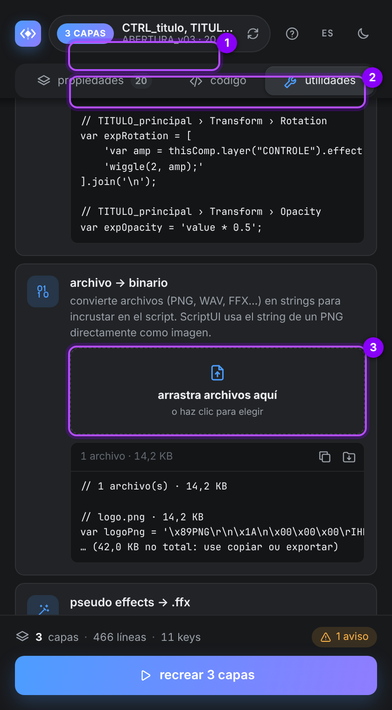</td>
    <td>

1. **expresión → string** → toma la expresión de la propiedad seleccionada; con un grupo seleccionado (un efecto, el transform…), las expresiones de dentro; sin nada seleccionado dentro de la capa, todas las suyas…
2. … y la formatea como string JS, una línea por elemento, lista para pegar en un script. copia o exporta desde la barra.
3. **archivo → binario** → arrastra archivos (PNG, WAV, FFX…) o haz clic para elegirlos (hasta 20 MB en total: el string queda unas 4 veces más grande que el archivo). BIN genera una variable con el contenido de cada uno, más la función `binToFile()` para guardarlo de vuelta en disco. en ScriptUI, el string de un PNG sirve directamente como imagen.
4. **pseudo effects → .ffx** → cada pseudo effect de la captura (matchName `Pseudo/…`) tiene el botón **guardar .ffx**: BIN selecciona solo ese efecto en la capa original y abre el *Save Animation Preset* de After Effects. el archivo es del propio AE y lleva la definición del efecto. guardado en la carpeta por defecto (User Presets), BIN lo encuentra solo; guardado en otro lugar, usa **elegir .ffx**. el .ffx entra incrustado en el script generado: en un equipo sin el efecto en PresetEffects.xml, el script aplica el .ffx en una comp temporal para registrar el efecto, borra la comp y lo crea normalmente. BIN recuerda el .ffx de cada pseudo effect. al capturar una capa o comp con pseudo effects aún sin .ffx, BIN propone guardarlos (**guardar .ffx**, o **guardar los N**, un diálogo a la vez); en la pestaña propiedades, la fila del pseudo effect tiene la etiqueta **.ffx** (verde cuando entra en el script; clic para guardar).

  </td>
  </tr>
</table>

<table>
  <tr>
    <td width="300"></td>
    <td>

1. **tema** → alterna entre automático (sigue el brillo de la interfaz de After Effects), claro y oscuro.

  </td>
  </tr>
</table>

<br>

---


## 📚 documentar plantillas de padeiro

**[BIN docs](docs-app/README.md)** (en portugués) es una app web que convierte el paquete de documentación de BIN, junto con capturas de los controles, en un borrador de documentación escrito por un agente (un workflow de n8n con OpenAI). lo revisas, pides ajustes y exportas el `.md` (o un `.zip` con las imágenes, para AFFiNE). su interfaz está solo en portugués.

<p align="center">
  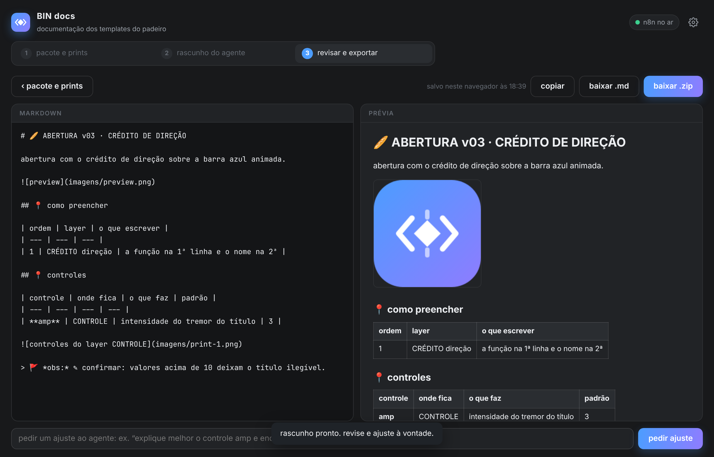
</p>

<br>

---

## 🧩 qué se recrea

| | |
|---|---|
| **tipos de capa** | forma, texto (de punto y de párrafo), sólido, ajuste, null, cámara, luz, precomp y material (buscados en el proyecto por nombre; el material se vuelve a importar desde la ruta original si existe) |
| **atributos** | nombre, etiqueta, comentario, entrada / salida, inicio, stretch, 3D, desenfoque de movimiento, modo de fusión, calidad, guía, shy, orientación automática, time remap, bloqueada… |
| **propiedades** | valores (lo que volvió al valor por defecto del transform, como escala al 100 %, queda fuera), keyframes (interpolación, easing, tangentes espaciales, continuidad, auto-bezier, roving), expresiones (incluso desactivadas), posición con dimensiones separadas |
| **grupos** | grupos de forma y todos sus elementos, efectos (incluso desactivados), máscaras (modo, invertida, calado, color), animadores de texto con selectores |
| **texto** | fuente, tamaño, color, trazo, alineación, tracking, interlineado, caja de texto y, en AE 24.3+, estilos distintos por tramo |
| **marcadores** | comentario, duración, etiqueta, capítulo, URL, cue point y parámetros |
| **entre capas** | parent (sin saltar la posición) y track matte |
| **comps** | tamaño, duración, velocidad de fotogramas, color de fondo, inicio del código de tiempo, área de trabajo, desenfoque de movimiento y obturador, fusión de fotogramas, shy, borrador 3D, procesador, etiqueta, comentario, marcadores y precomps anidadas |
| **pseudo effects** | recreados con sus valores; con el .ffx guardado en la pestaña utilidades, también en equipos sin el efecto en `PresetEffects.xml` (sin el .ffx, el script avisa y sigue con el resto) |
| **essential graphics** | los controles de la comp (nombre, orden y de dónde vienen), el nombre de la plantilla y, en las capas de precomp, los valores cambiados y las expresiones (incluso desactivadas) de las essential properties |

**no se recrean:** estilos de capa (la API de After Effects no permite añadirlos), máscaras de efecto y grupos de Essential Graphics. el panel avisa cuando la capa usa alguno de ellos.

<br>

---

## 🛠 desarrollo

```
bin-cep/
  CSXS/manifest.xml   com.jmbillard.bin · AE 17.0+
  index.html · css/style.css
  i18n/textos.csv     textos en pt, en y es
  js/cep.js           puente con After Effects y el disco
  js/i18n.js          traducciones (lee textos.csv)
  js/ui.js            iconos, sugerencias y avisos
  js/codegen.js       captura → script (sin DOM: también corre en Node)
  js/app.js           el panel
  jsx/host.jsx        captura de las capas (solo lectura) y ejecución
  icons/              iconos de la pestaña
tests/                pruebas, el After Effects simulado y los generadores de capturas
```

```bash
node tests/roundtrip.js      # ida y vuelta: todos los tipos de capa y una comp con precomps anidadas
node tests/run_panel.js      # panel de punta a punta + capturas en tests/out
node tests/i18n_check.js     # traducciones: CSV completo, script generado y panel en inglés y español
node tests/installer_preview.js docs/img/es es  # ejecuta el instalador en un ScriptUI simulado y dibuja cada paso
node tests/make_docs.js es   # capturas del README con marcas numeradas (docs/img/es)
node tests/make_demo.js es   # graba el uso simulado y genera docs/img/es/demo.gif (requiere ffmpeg)
```

para depurar el panel dentro de After Effects, con `PlayerDebugMode` activado, abre `http://localhost:8098` en Chrome.
