<p align="center">
  
</p>

# BIN

🗨️ **pt-BR** ⚡ extensão do After Effects para **engenharia reversa de layers** ⚡

O **BIN** lê as layers selecionadas (ou uma **comp inteira**, com as precomps) e gera um script **.jsx** que recria tudo do zero, em qualquer projeto: propriedades, keyframes com easing e tangentes, expressões, efeitos, máscaras, shapes, textos, markers, parentesco, track matte e as configurações da comp.

Serve para transformar um layout pronto em ferramenta: o script gerado pode virar um botão de outro painel, um template ou um trecho de automação.

<p align="center">
  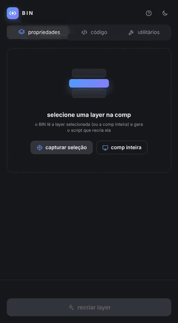<br>
  <sub>o painel em ação: capturar, tirar uma propriedade e um efeito, ver o código, recriar e a comp inteira.</sub>
</p>

> 📂 **arquivos:**\
> • **INSTALAR O BIN.jsx** → instalador (roda dentro do After Effects).\
> • **bin-cep/** → a extensão (painel CEP).\
> • **instalar_windows.bat** / **instalar_mac.command** → instaladores alternativos, sem abrir o After Effects.\
> • **bin.js** → versão anterior (script ScriptUI), mantida só como referência.

<br>

## 📑 índice

1. [instalar](#1--instalar)
2. [capturar](#2--capturar)
3. [escolher o que entra no script](#3--escolher-o-que-entra-no-script)
4. [comp inteira](#4--comp-inteira)
5. [o código gerado](#5--o-código-gerado)
6. [recriar, copiar e exportar](#6--recriar-copiar-e-exportar)
7. [utilitários](#7--utilitários)
8. [o que é recriado](#-o-que-é-recriado)
9. [para desenvolver](#-para-desenvolver)

<br>

---

## 1 · instalar

> ✅ **requisitos:** After Effects **2020 (17.0)** ou mais novo.

**1.1** no After Effects, abra `File` > `Scripts` > `Run Script File...` e escolha o **INSTALAR O BIN.jsx** direto da pasta do BIN (a pasta que tem a `bin-cep` dentro).

**1.2** o instalador confere o que é necessário. se a escrita de arquivos estiver bloqueada, use o link **› abrir preferências de scripts e expressões**, marque *Allow Scripts to Write Files and Access Network* e clique em **› verificar de novo**.

<table>
  <tr>
    <td align="center">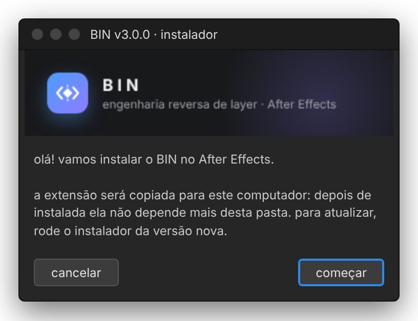<br><sub>1.1 · boas-vindas</sub></td>
    <td align="center">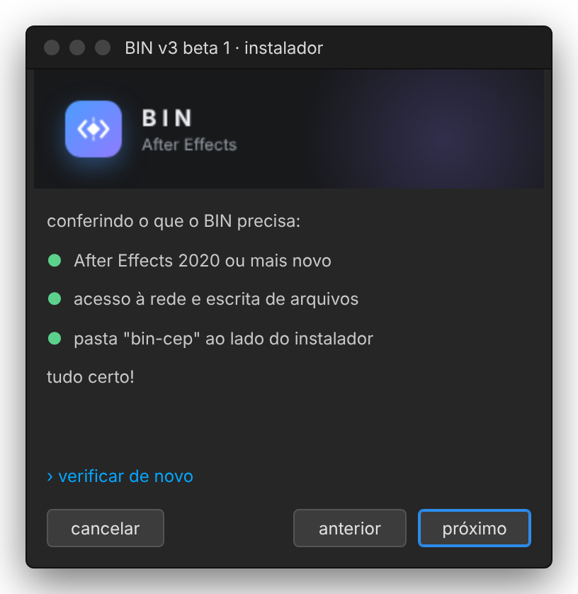<br><sub>1.2 · checagem</sub></td>
  </tr>
</table>

com tudo certo, **começar** pula a checagem e vai direto para instalar / atualizar (a checagem continua em **anterior**). se algo falhar, o instalador para nela e explica o que resolver.

**1.3** escolha **instalar** (ou **atualizar** / **reinstalar**; **remover** desinstala) e **reinicie o After Effects**.

<table>
  <tr>
    <td align="center">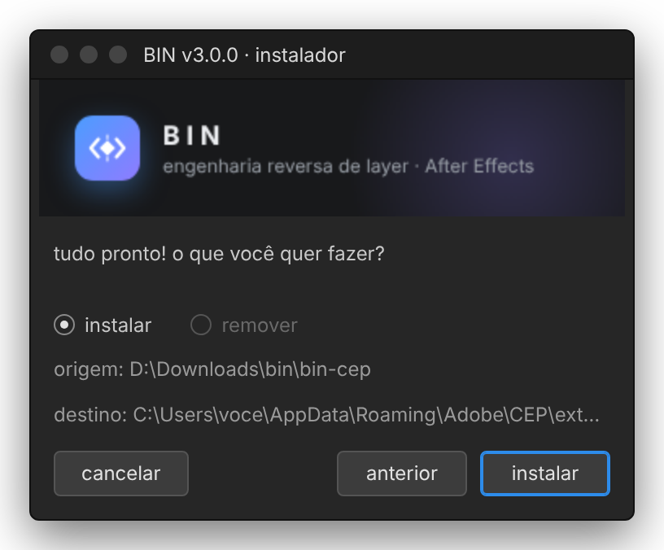<br><sub>1.3 · ação</sub></td>
    <td align="center">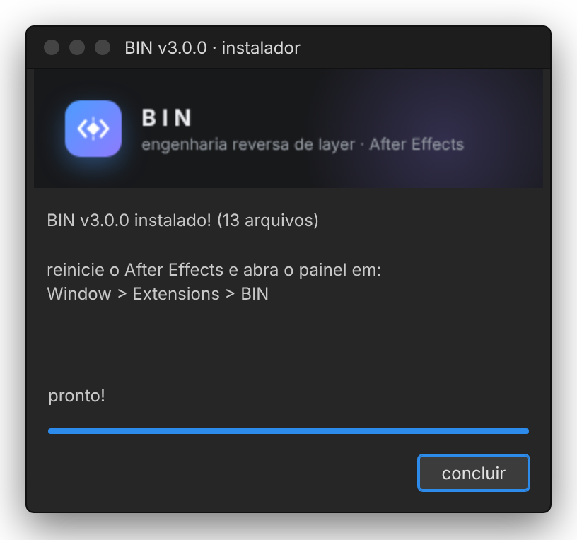<br><sub>1.3 · concluído</sub></td>
  </tr>
</table>

**1.4** abra o painel em `Window` > `Extensions` > `BIN`.

> 💡 sem abrir o After Effects: rode **instalar_windows.bat** (Windows) ou **instalar_mac.command** (macOS). os dois fazem a mesma cópia e liberam extensões sem assinatura (`PlayerDebugMode`).

<br>

---

## 2 · capturar

abra o painel em `Window` > `Extensions` > `BIN`. ele pode ser encaixado em qualquer lugar da área de trabalho, como os outros painéis.

<table>
  <tr>
    <td width="300">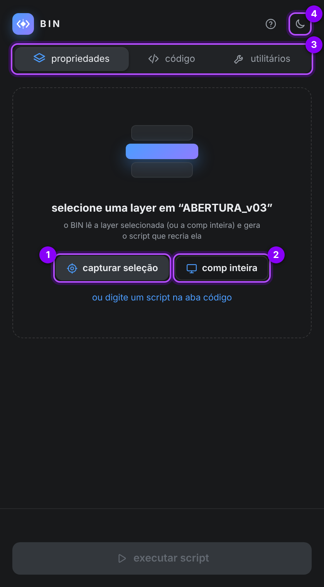</td>
    <td>

1. **capturar seleção** → lê as layers selecionadas na comp ativa.
2. **comp inteira** → lê a comp ativa com todas as layers e as precomps. veja a [seção 4](#4--comp-inteira).
3. **abas** → `propriedades`, `código` e `utilitários` (atalhos `1` `2` `3`).
4. **tema** → automático (segue o After Effects), claro ou escuro.

  </td>
  </tr>
</table>

a captura é **somente leitura**: nada no projeto é alterado e o histórico de undo fica limpo.

<br>

---

## 3 · escolher o que entra no script

<table>
  <tr>
    <td width="300">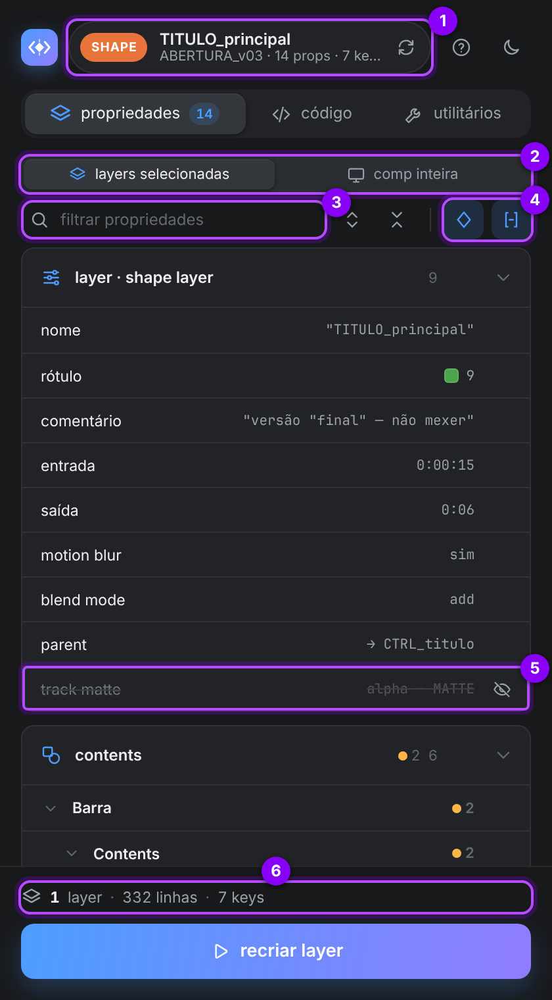</td>
    <td>

1. **chip** → tipo da layer (`SHAPE`, `TEXT`, `SOLID`, `NULL`, `ADJ`, `CAM`, `LUZ`, `COMP`, `MÍDIA`), comp de origem e contagens. clique (ou `Ctrl/⌘ + L`) para atualizar a captura. o painel acompanha a seleção no After Effects: quando ela muda (ou, no modo comp inteira, quando outra comp fica ativa), o chip fica destacado e mostra **atualizar para “…”**, sem recapturar sozinho e sem mexer no resto da tela. na tela inicial, o botão já diz o que vai ser capturado.
2. **modo** → `layers selecionadas` ou `comp inteira`. trocar captura de novo.
3. **filtrar** → pelo nome da propriedade, do grupo ou da layer (`Ctrl/⌘ + F`).
4. **keyframes e expressões** → ligam e desligam no script inteiro. sem keyframes, cada propriedade recebe o valor do primeiro keyframe.
5. **linha fora do script** → clique na linha para tirar a propriedade; ela fica riscada. clique de novo para devolver.
6. **resumo** → layers, linhas do script e keyframes que entram.

  </td>
  </tr>
</table>

só aparecem as propriedades **modificadas**: diferentes do padrão, com keyframes ou com expressão. os **losangos** amarelos são keyframes e o **ƒ** violeta é uma expressão.

<table>
  <tr>
    <td width="300">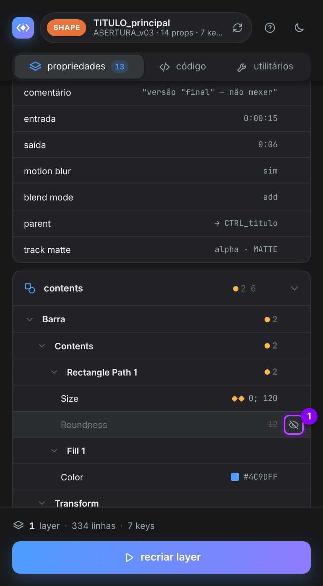</td>
    <td>

1. **olho** → aparece ao passar o mouse. nas propriedades, a linha inteira é clicável; em grupos, cards e layers, o olho tira o grupo inteiro (um efeito, uma máscara, um grupo de shape).

um olho azul fixo num grupo **fechado** avisa que parte dele está fora do script.

  </td>
  </tr>
</table>

<table>
  <tr>
    <td width="300">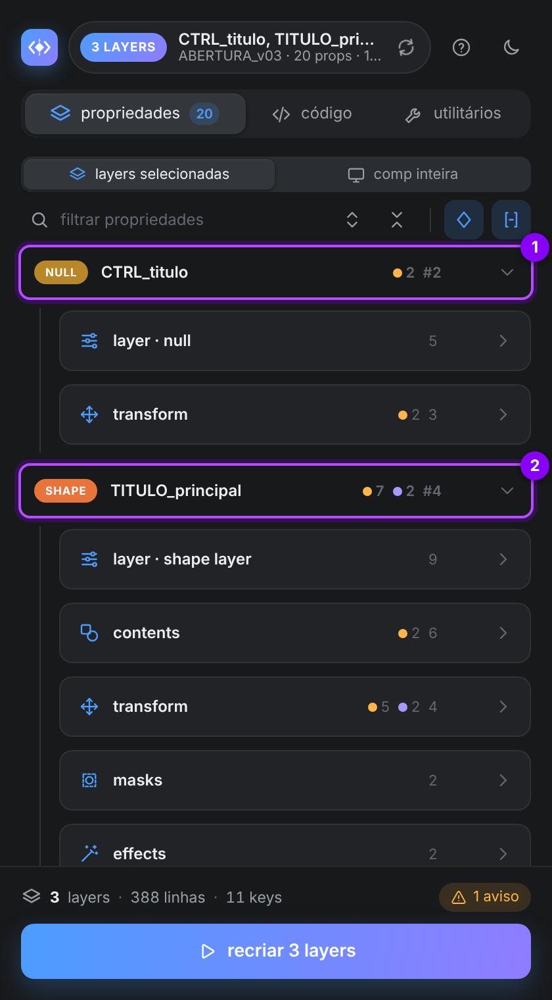</td>
    <td>

**1** **2** · **várias layers** → cada layer selecionada ganha um cabeçalho com o tipo, as contagens e o próprio olho. clique no cabeçalho para abrir ou fechar.

  </td>
  </tr>
</table>

passe o mouse sobre qualquer botão ou linha para ver a **dica**: o que ele faz e, quando houver, o atalho. nas propriedades, a dica mostra o nome interno no After Effects, os keyframes e o começo da expressão.

<p align="center">
  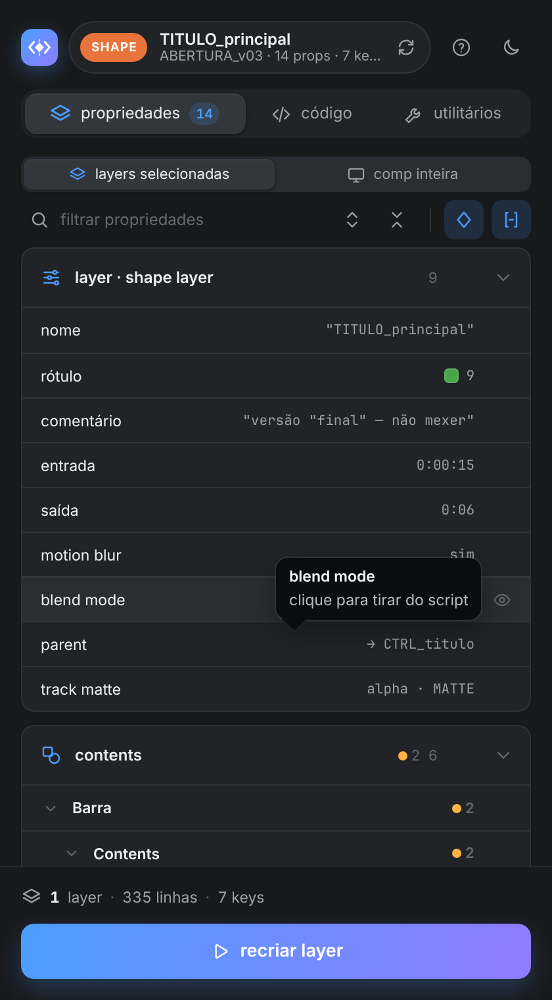
</p>

<br>

---

## 4 · comp inteira

no modo **comp inteira**, o BIN captura a comp ativa com todas as layers e também as **precomps** usadas dentro dela, em qualquer profundidade. o script gerado cria as comps no projeto, das mais internas para a principal, e liga cada layer de precomp à comp recém-criada.

<table>
  <tr>
    <td width="300">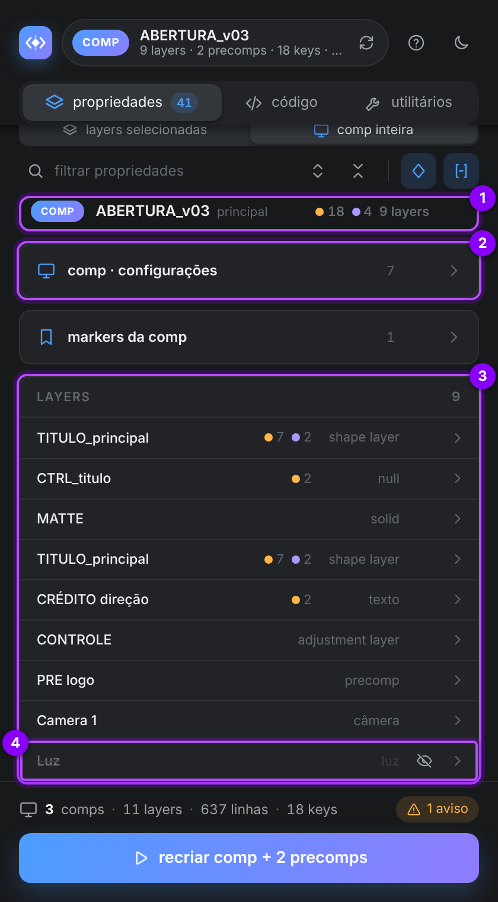</td>
    <td>

1. **comp principal** → sempre entra no script. as precomps aparecem abaixo, cada uma com o próprio cabeçalho e olho.
2. **configurações** → tamanho, duração e frame rate, mais o que for diferente do padrão: cor de fundo, work area, motion blur, shutter, renderizador…
3. **layers** → uma linha por layer, com as marcas de keyframes e expressões e o tipo. clique para abrir o detalhe.
4. **layer fora do script** → o olho, ao passar o mouse, tira a layer.

**tire uma precomp** (olho no cabeçalho dela) para não recriá-la: as layers que a usam procuram a comp original no projeto pelo nome, e as precomps que só ela usava saem junto.

  </td>
  </tr>
</table>

<table>
  <tr>
    <td width="300">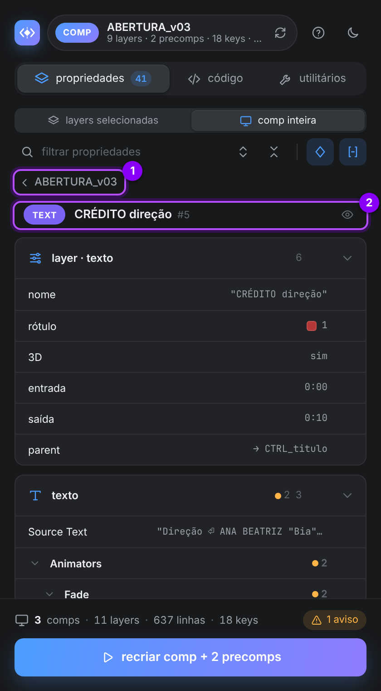</td>
    <td>

1. **voltar** → retorna para a lista na mesma posição (`Esc`).
2. **layer aberta** → o mesmo formato do modo layer, com o olho para tirar a layer inteira.

  </td>
  </tr>
</table>

<br>

---

## 5 · o código gerado

<table>
  <tr>
    <td width="300">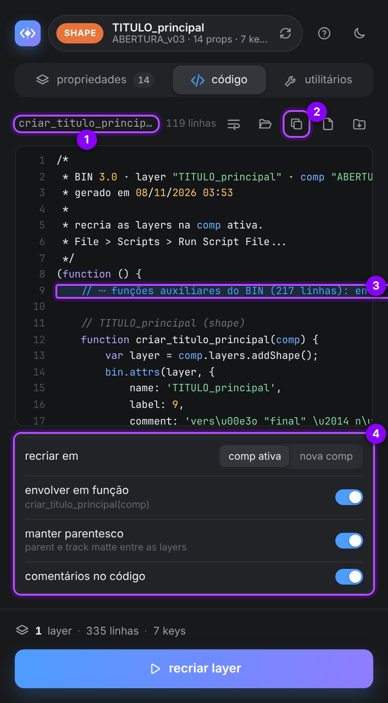</td>
    <td>

1. **arquivo** → nome sugerido para exportar e quantidade de linhas.
2. **copiar e exportar** → `Ctrl/⌘ + Shift + C` copia, `Ctrl/⌘ + S` salva o `.jsx`.

ao lado de copiar e exportar fica o **pacote para documentação**: um `.json` com a captura, o script e os arquivos do template do padeiro, para o [BIN docs](#-documentar-templates-do-padeiro).
3. **funções auxiliares** → recolhidas numa linha só; voltam inteiras ao rodar, copiar e exportar.
4. **opções** → veja a tabela abaixo.

  </td>
  </tr>
</table>

| opção | o que faz |
|---|---|
| **recriar em** | só no modo layers. `comp ativa` usa a comp aberta quando o script roda. `nova comp` cria uma comp igual à de origem (configurações e markers). no modo comp, o script sempre cria as comps. |
| **envolver em função** | uma função `criar_nome_da_layer(comp)` por layer, fácil de reaproveitar (no modo comp, mais uma `criar_comp_nome()` por comp). desligado, gera o código corrido. |
| **manter parentesco** | refaz parent e track matte. se o parent não foi capturado junto, o script procura uma layer com o mesmo nome na comp. |
| **comentários no código** | separa os blocos com comentários. |

a aba código é um **editor**: dá para mexer no código gerado antes de rodar. a partir da primeira edição, um aviso lembra que mudanças nas propriedades e nas opções não chegam mais ao código, e **descartar edições** volta ao código gerado.

<table>
  <tr>
    <td align="center">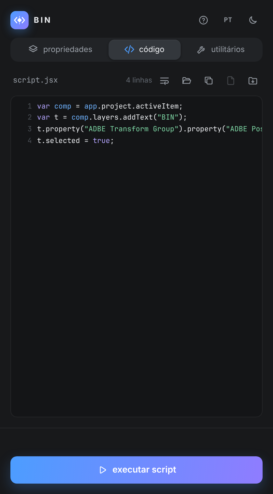<br><sub>script livre, sem captura</sub></td>
    <td align="center">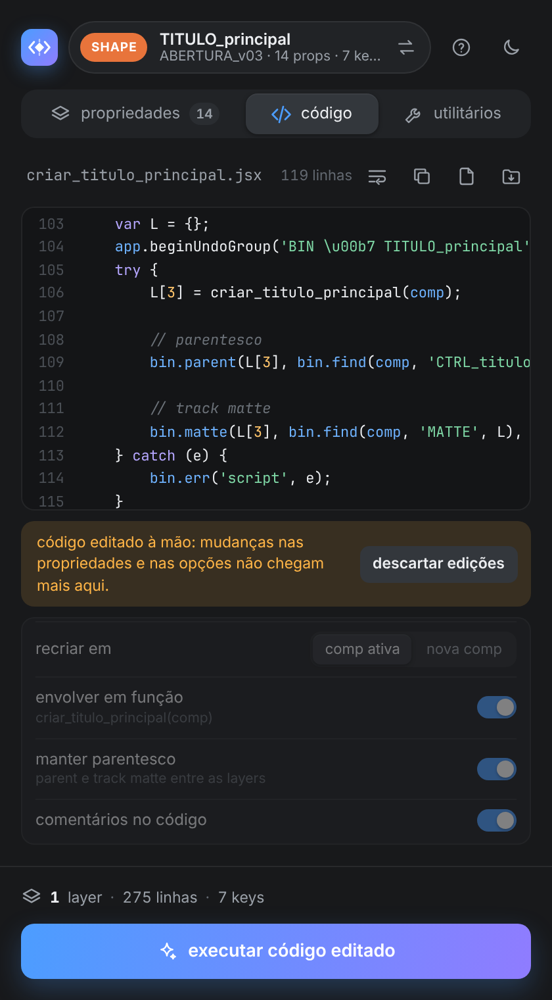<br><sub>código gerado editado à mão</sub></td>
  </tr>
</table>

sem nenhuma captura, o editor vira um **rascunho livre**: digite qualquer script do After Effects (ExtendScript) e execute com **executar script** ou `Ctrl/⌘ + Enter`. o rascunho fica salvo no painel, e o painel abre na última aba usada. no estado vazio, **ou digite um script na aba código** leva direto para lá. todo script roda dentro de um único undo, e um erro mostra a linha certa do editor (com o botão **ir para a linha**).

para abrir um script pronto, **arraste o arquivo** (`.jsx`, `.js`, `.jsxinc` ou `.txt`) para qualquer lugar do painel, fora da área do binário nos utilitários, ou use o botão **abrir script** da barra do código (`Ctrl/⌘ + O`). com uma captura, o script aberto entra como código editado (e **descartar edições** volta ao gerado). arquivos em UTF-8 ou Windows-1252 abrem com os acentos certos.

o script gerado é **autônomo**: roda em `File` > `Scripts` > `Run Script File...` em qualquer projeto, sem o painel. ele traz um pequeno objeto `bin` com funções auxiliares que aplicam cada propriedade separadamente. se uma propriedade não existir na versão do After Effects de destino, ela é pulada e listada no final, sem derrubar o resto. as **expressões entram por último**, quando todas as layers e comps já existem: nenhuma é avaliada antes das dependências (o que deixaria erros presos, como no expression selector). parâmetros de efeito que apontam para uma layer (3D Glasses, Displacement Map…) também são resolvidos no fim, pela layer recriada.

```js
function criar_titulo_principal(comp) {
	var layer = comp.layers.addShape();
	bin.attrs(layer, { name: 'TITULO_principal', label: 9 });

	// contents
	var contents = layer.property('ADBE Root Vectors Group');
	var barra = bin.add(contents, 'ADBE Vector Group', 'Barra');
	var rectanglePath1 = bin.add(barra.property('ADBE Vectors Group'), 'ADBE Vector Shape - Rect', 'Rectangle Path 1');
	bin.keys(rectanglePath1.property('ADBE Vector Rect Size'), [
		{ t: 0, v: [0, 120], i: 'BB', ei: [[0, 33], [0, 33]], eo: [[0, 75], [0, 75]] },
		{ t: 0.5338, v: [860, 120], i: 'BL' }
	]);

	// transform
	var transform = layer.property('ADBE Transform Group');
	bin.expr(transform.property('ADBE Rotate Z'), [
		'var amp = thisComp.layer("CONTROLE").effect("amp")("Slider");',
		'wiggle(2, amp);'
	].join('\n'));
	return layer;
}
```

<br>

---

## 6 · recriar, copiar e exportar

<table>
  <tr>
    <td width="300">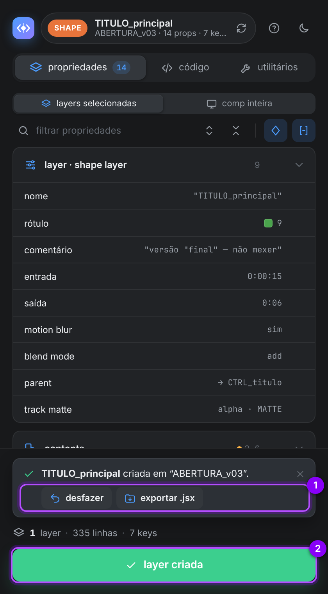</td>
    <td>

1. **desfazer e exportar** → o aviso de conclusão oferece desfazer tudo de uma vez e exportar o `.jsx` que acabou de rodar.
2. **recriar** → roda o script na hora, dentro de um único undo (`Ctrl/⌘ + Enter`). fica verde ao terminar.

o arquivo exportado é salvo em UTF-8 com BOM, que o ExtendScript lê com acentos corretos em qualquer sistema.

  </td>
  </tr>
</table>

<table>
  <tr>
    <td width="300">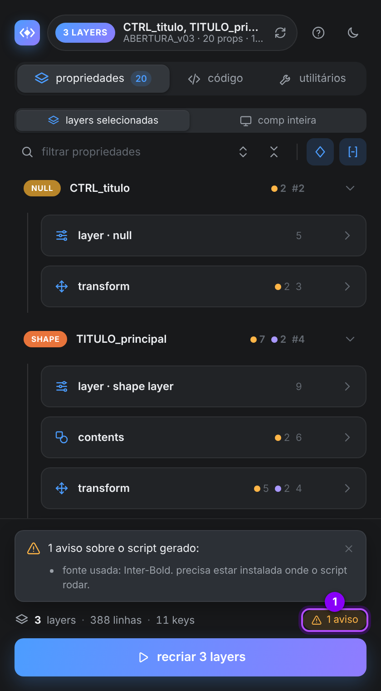</td>
    <td>

1. **avisos** → o que pode dar diferença em outro computador: fontes, plug-ins de terceiros, footage e precomps procurados no projeto pelo nome. passe o mouse para ver a lista; clique para ver tudo.

  </td>
  </tr>
</table>

<table>
  <tr>
    <td width="300">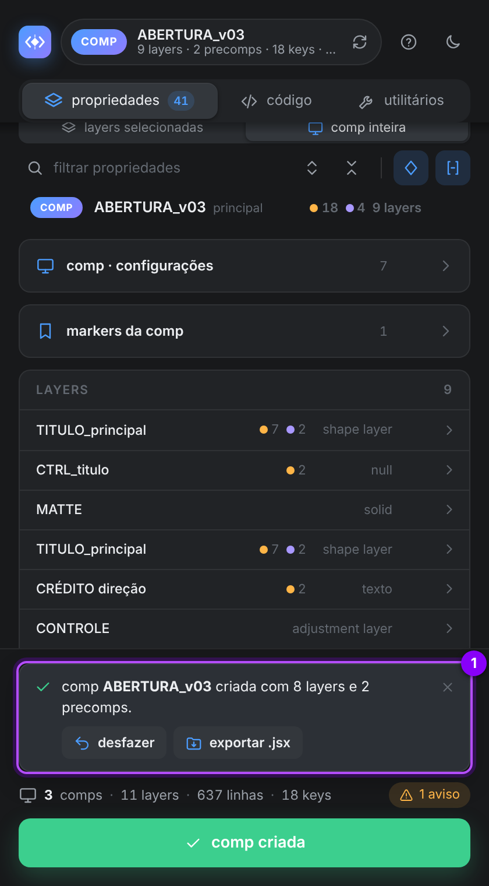</td>
    <td>

1. **comp recriada** → no modo comp, o aviso diz quantas layers e precomps foram criadas, e a comp nova abre no viewer.

  </td>
  </tr>
</table>

### ⌨️ atalhos

com o painel em foco:

| atalho | o que faz |
|---|---|
| `1` `2` `3` | abas propriedades, código e utilitários |
| `Ctrl/⌘ + L` | atualizar a captura (seleção ou comp ativa de agora) |
| `Ctrl/⌘ + F` | filtrar propriedades |
| `Ctrl/⌘ + Enter` | recriar (ou executar o script da aba código) |
| `Tab` (no editor) | insere tabulação |
| `Ctrl/⌘ + O` | abrir um script no editor |
| `Ctrl/⌘ + S` | exportar .jsx |
| `Ctrl/⌘ + Shift + C` | copiar o código |
| `Esc` | limpa o filtro, volta da layer aberta ou fecha o aviso |

<br>

---

## 7 · utilitários

<table>
  <tr>
    <td width="300">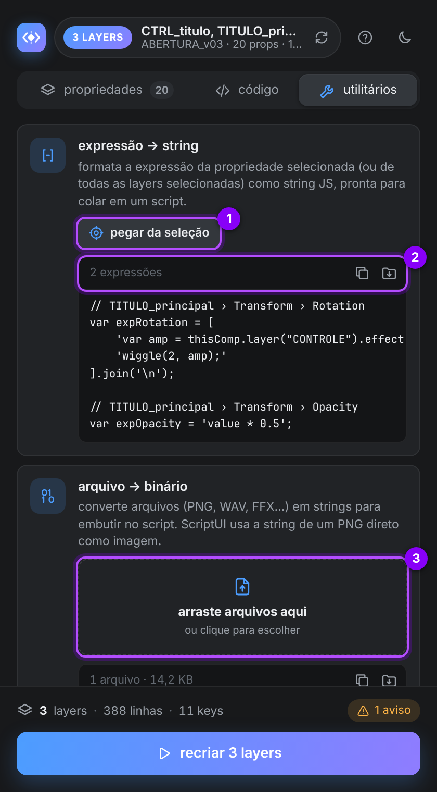</td>
    <td>

1. **expressão → string** → pega a expressão da propriedade selecionada (ou todas as expressões das layers selecionadas)…
2. … e formata como string JS, uma linha por item, pronta para colar em um script. copie ou exporte pela barra.
3. **arquivo → binário** → arraste arquivos (PNG, WAV, FFX…) ou clique para escolher. o BIN gera uma variável com o conteúdo de cada um, mais a função `binToFile()` para gravar de volta no disco. no ScriptUI, a string de um PNG já serve direto como imagem.

  </td>
  </tr>
</table>

<table>
  <tr>
    <td width="300">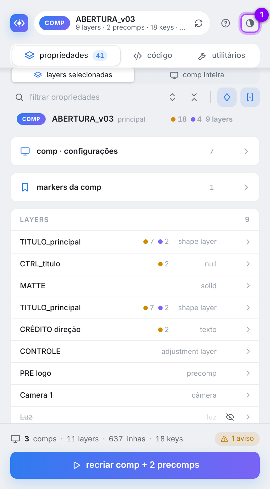</td>
    <td>

1. **tema** → alterna entre automático (segue o brilho da interface do After Effects), claro e escuro.

  </td>
  </tr>
</table>

<br>

---


## 📚 documentar templates do padeiro

o **[BIN docs](docs-app/README.md)** é um app web que transforma o pacote para documentação do BIN, junto com prints dos controles, num rascunho de documentação escrito por um agente (workflow do n8n com a OpenAI). você revisa, pede ajustes e exporta o `.md` (ou um `.zip` com as imagens, para o AFFiNE).

<p align="center">
  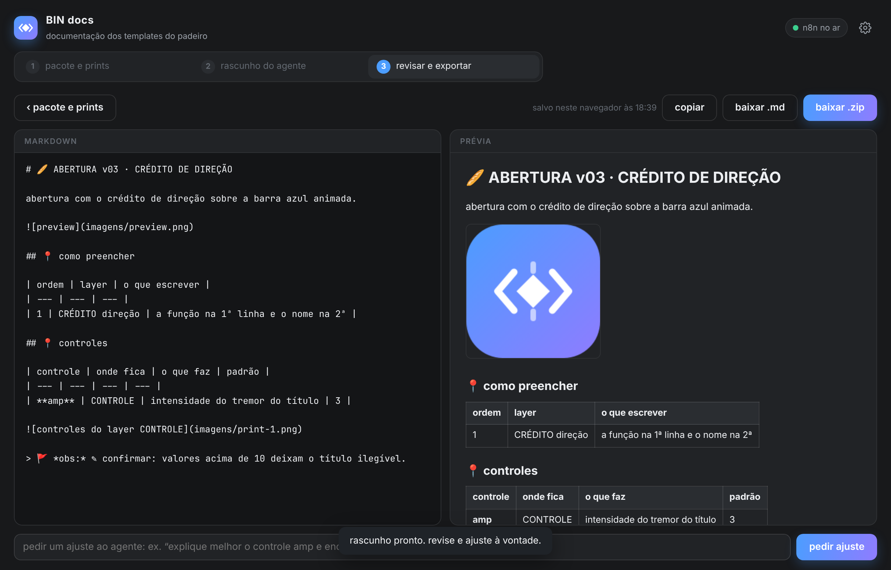
</p>

<br>

---

## 🧩 o que é recriado

| | |
|---|---|
| **tipos de layer** | shape, texto (ponto e caixa), solid, adjustment, null, câmera, luz, precomp e footage (procurados no projeto pelo nome; footage é reimportado do caminho original se existir) |
| **atributos** | nome, rótulo, comentário, entrada / saída, início, stretch, 3D, motion blur, blend mode, qualidade, guia, shy, auto-orient, time remap, travada… |
| **propriedades** | valores, keyframes (interpolação, easing, tangentes espaciais, continuidade, auto-bezier, roving), expressões (inclusive desligadas), posição com dimensões separadas |
| **grupos** | grupos de shape e todos os itens, efeitos (inclusive desligados), máscaras (modo, invertida, feather, cor), animators de texto com seletores |
| **texto** | fonte, tamanho, cor, contorno, alinhamento, tracking, entrelinha, caixa de texto e, no AE 24.3+, estilos diferentes por trecho |
| **markers** | comentário, duração, rótulo, capítulo, URL, cue point e parâmetros |
| **entre layers** | parent (sem pular a posição) e track matte |
| **comps** | tamanho, duração, frame rate, cor de fundo, início do timecode, work area, motion blur e shutter, frame blending, shy, draft 3D, renderizador, rótulo, comentário, markers e precomps aninhadas |

**não recriados:** estilos de layer (a API do After Effects não permite adicioná-los), máscaras de efeito e essential properties. o painel avisa quando a layer usa algum deles.

<br>

---

## 🛠 para desenvolver

```
bin-cep/
  CSXS/manifest.xml   com.jmbillard.bin · AE 17.0+
  index.html · css/style.css
  js/cep.js           ponte com o After Effects e o disco
  js/ui.js            ícones, dicas e avisos
  js/codegen.js       captura → script (sem DOM: roda também no Node)
  js/app.js           o painel
  jsx/host.jsx        captura das layers (somente leitura) e execução
  icons/              ícones da aba
tests/
  ae_mock.js          mock do modelo de objetos do After Effects
  roundtrip.js        captura → script → recria → captura de novo (tem que bater)
  run_panel.js        painel no Chromium com o host.jsx rodando no mock
  scene.js            comp de exemplo usada nos testes
  installer_preview.js  instalador num ScriptUI simulado
  pill_align.js       mede o alinhamento vertical do texto nas pílulas
  tab_ink.js          confere o fundo da aba ativa depois da captura
  tooltips.js         dicas (conteúdo, posição, modo aquecido) e atalhos de teclado
  code_editor.js      aba código como editor: script livre, código editado, erros e atalhos
  script_drop.js      abrir script no editor: arrastar o arquivo ou usar o botão abrir
  selection_watch.js  o painel acompanha a seleção do AE e avisa no chip quando a captura fica para trás
  micro_anim.js       gestos dos ícones no hover, sombra da rolagem e "reduzir movimento"
  lib_panel.js        abre o painel com o After Effects simulado (usado pelos geradores abaixo)
  make_docs.js        capturas do README com destaques
  make_demo.js        GIF do uso simulado
```

```bash
node tests/roundtrip.js      # ida e volta: 8 tipos de layer e uma comp com precomps aninhadas
node tests/run_panel.js      # painel de ponta a ponta + capturas de tela em tests/out
node tests/make_icons.js     # ícones da aba e logo
node tests/make_banner.js    # banner do instalador
node tests/installer_preview.js  # roda o instalador num ScriptUI simulado e desenha cada passo
node tests/make_docs.js      # capturas do README com os destaques numerados
node tests/make_demo.js      # grava o uso simulado e gera docs/img/demo.gif (precisa do ffmpeg)
node tests/docs_app.js       # BIN docs de ponta a ponta com um webhook falso
```

para depurar o painel dentro do After Effects, com o `PlayerDebugMode` ligado, abra `http://localhost:8098` no Chrome.
