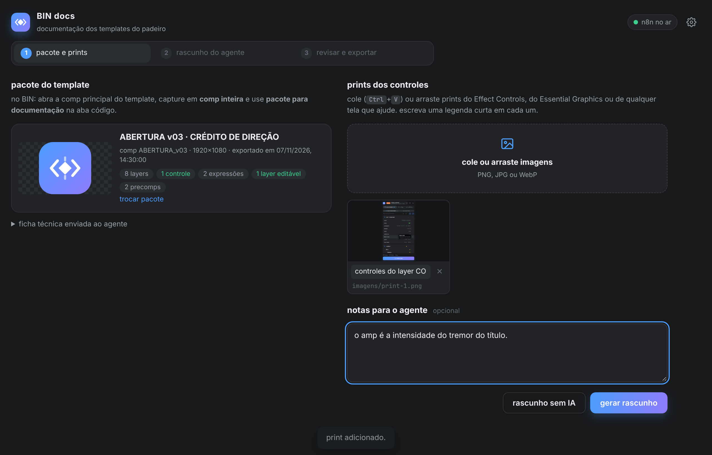
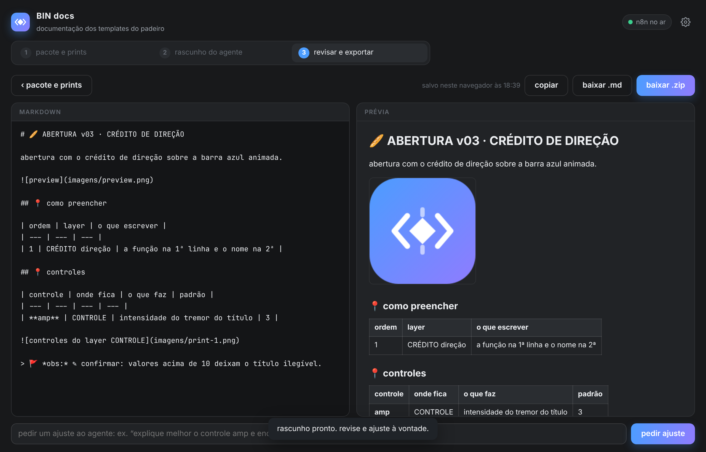

# BIN docs

🗨️ **pt-BR** ⚡ rascunhos de documentação dos templates do padeiro, escritos por um agente e revisados por você ⚡

o **BIN docs** é um app web (HTML, CSS e JS puros, sem build) que junta o que o BIN captura de um template com prints dos controles, envia tudo para um workflow do **n8n** e devolve um rascunho em markdown para você revisar, ajustar e exportar (`.md` ou `.zip` com as imagens, para importar no AFFiNE).

`1 pacote e prints` > `2 rascunho do agente` > `3 revisar e exportar`

<p align="center">
  <br>
  
</p>

<br>

## 📍 1 · o pacote do template (no BIN)

1. abra o projeto do template (o `.aep` / `.aet` da pasta do template, ao lado do `_config.json`).
2. abra a comp principal e, no BIN, capture em **comp inteira**.
3. na aba **código**, clique em **pacote para documentação** (ícone de arquivo) e salve o `.json`.

o pacote leva:

- a captura da comp (layers, controles, expressões, precomps, markers);
- o script gerado pelo BIN;
- do template, quando encontrado na pasta do projeto: o `_config.json`, o `_preview.png`, se existe `_script.js` e a lista da pasta `FONTS`.

> 🚩 *obs:*\
> • o BIN procura `<nome do projeto>_config.json`, a mesma regra do padeiro. se não achar, usa o `_config.json` da pasta cuja comp principal tem o nome da comp aberta.\
> • sem config, o pacote sai mesmo assim, e o app avisa.

## 📍 2 · prints e rascunho (no app)

1. arraste o pacote `.json` para o app (ou clique para escolher).
2. cole (`Ctrl/⌘ + V`) ou arraste os prints dos controles: Effect Controls, Essential Graphics, telas do template. escreva uma **legenda** em cada um: é por ela que o agente sabe o que o print mostra.
3. se quiser, escreva **notas para o agente** (para que o template serve, o que não mexer…). as notas têm prioridade sobre o que o agente deduzir.
4. clique em **gerar rascunho** (`Ctrl/⌘ + Enter`).

a **ficha técnica** (aberta em "ficha técnica enviada ao agente") é o resumo que o agente recebe no lugar do script inteiro: configuração do padeiro, layers preenchidos, controles de expressão e o que cada um afeta (lido das expressões), expressões, layers, textos, precomps e mídias.

**rascunho sem IA** monta um esqueleto a partir da ficha, com tabelas e marcas `✎` para completar, sem chamar o n8n.

## 📍 3 · revisar e exportar

- editor markdown à esquerda, prévia à direita (com os prints no lugar).
- **pedir ajuste** → manda o texto atual e o pedido ("encurte a introdução", "explique melhor o controle amp") para o agente. **desfazer ajuste** volta ao texto anterior.
- o rascunho é salvo neste navegador enquanto você edita. ao carregar o pacote do mesmo template de novo, o app oferece **abrir rascunho salvo**.
- **baixar .md** → só o texto.
- **baixar .zip** (`Ctrl/⌘ + S`) → o `.md` e a pasta `imagens/` com as imagens citadas no texto.

### levando para o AFFiNE

no AFFiNE, use **importar** > **Markdown com mídia** (o `.zip`) para trazer o texto com as imagens, ou **Markdown** para só o `.md`. a importação direta pelo n8n fica para uma próxima etapa (veja abaixo).

<br>

## 📍 o workflow do n8n

arquivos em [`n8n/`](n8n):

| arquivo | o que é |
| --- | --- |
| `workflow.json` | o workflow pronto para importar no n8n |
| `prompt.md` | as instruções do agente (estilo, estrutura, regras) |
| `build_workflow.js` | gera o `workflow.json` com o `prompt.md` embutido: edite o prompt e rode `node docs-app/n8n/build_workflow.js` |

```
recebe o pacote (webhook POST /bin-docs) → monta o pedido (Code) → OpenAI (HTTP, chat completions com visão)
→ extrai o markdown (Code) → responde ao app
healthcheck (webhook GET /bin-docs-health) → responde ok
```

**instalação:**

1. no n8n, **Import from file** e escolha `n8n/workflow.json`.
2. no nó **OpenAI**, escolha a credencial da OpenAI (a mesma usada nos nós da OpenAI do n8n).
3. no nó **recebe o pacote**, crie uma credencial **Header Auth** com o nome `X-Bin-Token` e um valor secreto. é esse valor que vai no campo "token" do app.
4. no nó **monta o pedido**, troque o modelo em `const MODEL = 'gpt-4o'` se preferir outro modelo da OpenAI com visão.
5. ative (publique) o workflow e copie as URLs de produção dos dois webhooks.
6. no app, clique em ⚙ e cole: webhook do rascunho, healthcheck e o token.

> 🚩 *obs:*\
> • o webhook aceita qualquer origem (CORS `*`), porque o app pode rodar em qualquer endereço. o token é o que impede outras pessoas de usarem a sua cota da OpenAI.\
> • os endereços também podem ficar fixos no topo de `js/app.js` (`CONFIG`), como no FilmeBOT.

### contrato do webhook

o app envia `multipart/form-data` (POST), com o cabeçalho `X-Bin-Token`:

| campo | conteúdo |
| --- | --- |
| `mode` | `draft` (rascunho novo) ou `revise` (ajuste) |
| `request_id` | identificador do pedido |
| `template_name`, `comp_name` | nome da configuração e da comp principal |
| `ficha` | a ficha técnica em markdown |
| `notes` | notas do autor |
| `images` | JSON: `[{ field, file, caption }]`: o campo do arquivo, o caminho que o markdown deve usar (`imagens/print-1.png`) e a legenda |
| `summary` | JSON com controles, layers editáveis, textos, mídias, precomps e avisos |
| `preview`, `image_0`, `image_1`… | os arquivos (só no `draft`) |
| `markdown`, `instruction` | o texto atual e o pedido (só no `revise`) |

resposta esperada: `200` com `{ "markdown": "…" }` (também aceita o markdown em texto puro). em erro, qualquer status diferente de 2xx; o corpo aparece no aviso do app.

<br>

## 📍 para desenvolver

```
docs-app/
  index.html · css/styles.css
  js/ficha.js         pacote do BIN → ficha técnica (sem DOM: roda no Node)
  js/app.js           o app
  n8n/                workflow, prompt e o gerador do workflow
  exemplo/            pacote de exemplo (da comp de teste do BIN) e a ficha dele
```

```bash
node tests/make_doc_pack.js            # gera docs-app/exemplo a partir da comp de teste
node tests/docs_app.js                 # app de ponta a ponta com um webhook falso (18 checks)
node docs-app/n8n/build_workflow.js    # workflow.json a partir do prompt.md
N8N_BIN=n8n node tests/n8n_workflow.js # o workflow num n8n de verdade, com uma OpenAI falsa local (14 checks)
```

o teste do workflow sobe um n8n temporário (o n8n 2.x precisa do Node 24), importa as credenciais e o workflow, ativa e confere: healthcheck, token recusado, CORS (o OPTIONS do navegador e a resposta do POST), o que chega na OpenAI (prompt, ficha, notas e as imagens em base64), o ajuste e o erro 502 quando a OpenAI cai. testado no n8n 2.46.6.

para abrir o app, sirva a pasta `docs-app/` em qualquer servidor estático (ou abra o `index.html` direto no navegador).

### próximas etapas

- **AFFiNE direto**: criar o documento pelo n8n, sem baixar e importar. depende da API da sua instância.
- **integração no BIN**: enviar o pacote e os prints direto do painel, sem o arquivo intermediário.
